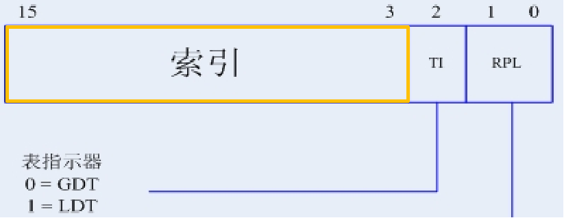
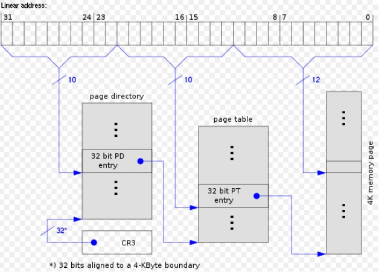

# Linux 虚拟内存与 x86 地址转换

程序使用地址访问代码和数据，但程序看到的地址通常不是内存条上的物理位置。操作系统与处理器把每个进程的虚拟地址映射到物理页框，并在映射中施加读、写、执行和特权限制。理解这层间接关系，有助于解释隔离、缺页、内存映射与缓存行为。

## 从程序地址到物理地址

教材使用的地址术语与体系结构有关，不能脱离 CPU 模式硬套：

- **逻辑地址**在经典 x86 保护模式教材中指“段选择符 + 段内偏移”。段选择符是 16 位，含索引、表选择位和请求特权级；它在 GDT 或 LDT 中找到段描述符。段描述符本身通常是 8 字节，含基址、限长和权限等字段。它们不是同一种东西。
- **线性地址**是分段转换后交给分页单元的地址。旧版 IA-32 教材常把它叫线性地址；操作系统和应用开发中也常把程序使用的地址统称为虚拟地址。
- **物理地址**是最终用于访问物理内存或内存映射设备的地址。用户程序通常不能直接由自己的指针推断出这个地址。

在传统保护模式下，概念上的转换是：

$$
\text{段选择符} + \text{偏移}
\rightarrow \text{线性地址}
\rightarrow \text{物理地址}
$$

第一步查描述符并执行段权限检查，第二步查页表并执行页权限检查。若未启用分页，线性地址可直接成为物理地址；普通用户程序不应依赖这种模式。

Linux 在 IA-32 上通常采用近似“平坦”的代码段和数据段：段基址为零，应用地址主要由分页机制隔离。因此“逻辑、线性和虚拟地址”在许多 Linux 讨论中会被混用，但从硬件定义看，它们仍有不同含义。进入 x86-64 长模式后，普通段基址/限长不再用于常规地址转换；FS/GS 基址仍有特定用途，例如线程局部存储。需要精确位域时以当前 Intel SDM 与处理器模式为准。

## 分页、页表与缺页

分页把虚拟地址切成固定大小的页，把物理内存切成同样大小的页框。页表项把虚拟页号映射到页框号，并携带存在位、权限位、访问/修改状态等处理器相关标志。页内偏移不变：

$$
\text{物理地址}
=
\text{页框基址}
+
\text{页内偏移}
$$

页表把同一虚拟地址空间映射到不同物理页框，使进程间隔离成为可能；页也无需在物理内存中连续。多级页表按需为已使用的地址区域建立下级表，从而避免为庞大的稀疏地址空间一次性分配完整映射表。

经典 **32 位 IA-32、非 PAE、4 KiB 页**模型把线性地址切为 10 位目录索引、10 位页表索引和 12 位页内偏移。单级页表需要 `2^20` 个表项；若每项 4 字节，一个完整 4 GiB 地址空间的页表需 4 MiB。二级页表只为实际需要的区域分配页表。这个计算说明层级结构节省空间，并不表示现代 Linux 使用这个固定布局。

以地址 `0x20021406` 为例：

| 字段 | 计算 | 结果 |
| --- | --- | --- |
| 目录索引 | `(地址 >> 22) & 0x3ff` | `0x080` |
| 页表索引 | `(地址 >> 12) & 0x3ff` | `0x021` |
| 页内偏移 | `地址 & 0xfff` | `0x406` |

若示例页表项映射到页框基址 `0x00abc000`，物理地址就是 `0x00abc406`。这是旧式非 PAE IA-32 的位域演算，不是对某台机器物理地址的查询。

**缺页异常不等于程序一定崩溃。** 若地址合法但页面当前未映射到 RAM，内核可能分配页面、从文件映射装入内容，或执行写时复制后再恢复指令。若地址不合法或权限不允许，进程通常会收到访问错误信号。程序的虚拟地址空间也可能比当前驻留在物理 RAM 的部分大得多。

## 必须区分的历史 x86 模型

旧教材中的 IA-32 表格有明确适用边界：

| 模型 | 虚拟地址/分页结构 | 物理地址能力 | 教材概念 |
| --- | --- | --- | --- |
| IA-32 非 PAE，4 KiB 页 | 32 位线性地址；两级分页为 10 + 10 + 12 位 | 32 位物理地址上限 | 4 KiB 页，也可用传统 4 MiB 大页 |
| IA-32 PAE，4 KiB 页 | 32 位线性地址；PDPT 4 项，后续索引为 9 + 9 + 12 位 | 经典 PAE 将可寻址物理地址扩展到 36 位；具体 CPU 支持可能不同 | PAE 扩展物理地址，不把 32 位进程虚拟地址变成 64 位 |
| x86-64 Linux | 虚拟地址位宽和四级/五级页表取决于 CPU、内核配置与运行模式 | 取决于处理器实现及内核配置 | Linux 维护通用页表层级，体系结构代码可折叠不需要的层级 |

PAE 页表项为 64 位；4 KiB 页的经典层级可写成 2 + 9 + 9 + 12 位。使用大页时，IA-32 PAE 的页目录项可直接映射 2 MiB 页。不要把“PAE 下大页 2 MiB”和“非 PAE 的 4 MiB 大页”混为一谈。

Linux 内核的通用页表定义五层抽象；体系结构可将不需要的层折叠。x86-64 常见配置有四级页表，启用五级分页的系统有不同的虚拟地址布局。用户空间上限、内核空间边界、物理内存直接映射区和高端内存都不能从 32 位教材中的固定地址推断。

## 页表缓存与数据缓存

访问虚拟地址时，MMU 需要页表完成地址转换。**TLB** 缓存近期的地址转换；TLB 未命中时才需遍历页表。修改映射或切换地址空间时，内核必须按体系结构规则维护 TLB，不能把 TLB 当作与普通数据缓存完全相同的缓存。

CPU 的 L1/L2/L3 数据缓存则保存近期访问的数据缓存行。顺序访问和具有空间/时间局部性的访问模式通常能更好地复用缓存；跨步过大、工作集超出缓存或多个线程争用数据可能降低命中率。缓存行大小、层级、替换策略与一致性协议由处理器实现决定；教材里“访问需要几个时钟周期”只能是特定处理器上的测量，不能当作常数。

多核系统通常由硬件缓存一致性协议维护普通缓存行的一致性。应用仍需遵守 C++ 内存模型：共享变量若被并发读写且没有适当同步，硬件缓存一致性不会自动消除数据竞争。任务队列、线程同步及实时日志背压见[软件模块与异步任务](../ROS与软件架构/软件模块与异步任务.md)的“单消费者任务队列”和“日志背压与观测”章节。

## 文件映射与物理内存

Linux 虚拟内存区域可以映射匿名内存、可执行文件或其他文件；映射不表示所有页面都已驻留在 RAM。文件页可通过页缓存共享，私有映射在写入时可触发复制。物理内存也含内核、固件、设备映射等保留区域，操作系统不会把每个物理地址范围都交给普通分配器。

不要将以下概念等同：

- **虚拟地址空间大小**表示进程可寻址的区域，不等于已使用的 RAM。
- **RSS**大致表示当时驻留的进程页面；共享映射会使按进程统计存在口径差异。
- **页框号**由物理地址按页大小换算而来，不是用户态指针。
- **磁盘交换空间**可承载部分匿名页面，但它不是速度相当于 RAM 的“另一块内存”。

## 延伸阅读

- [Intel 64 and IA-32 Architectures Software Developer Manuals](https://www.intel.com/content/www/us/en/developer/articles/technical/intel-sdm.html)：保护模式分段、IA-32 PAE、Intel 64 长模式与分页的体系结构规范。
- [Linux 内核文档：Page Tables](https://docs.kernel.org/mm/page_tables.html)：Linux 通用页表层级、虚拟地址到物理页框的映射。
- [Linux x86-64 Memory Management](https://kernel.org/doc/html/latest/arch/x86/x86_64/mm.html)：特定 x86-64 内核配置的虚拟内存布局示例；文档会随内核版本变化。
