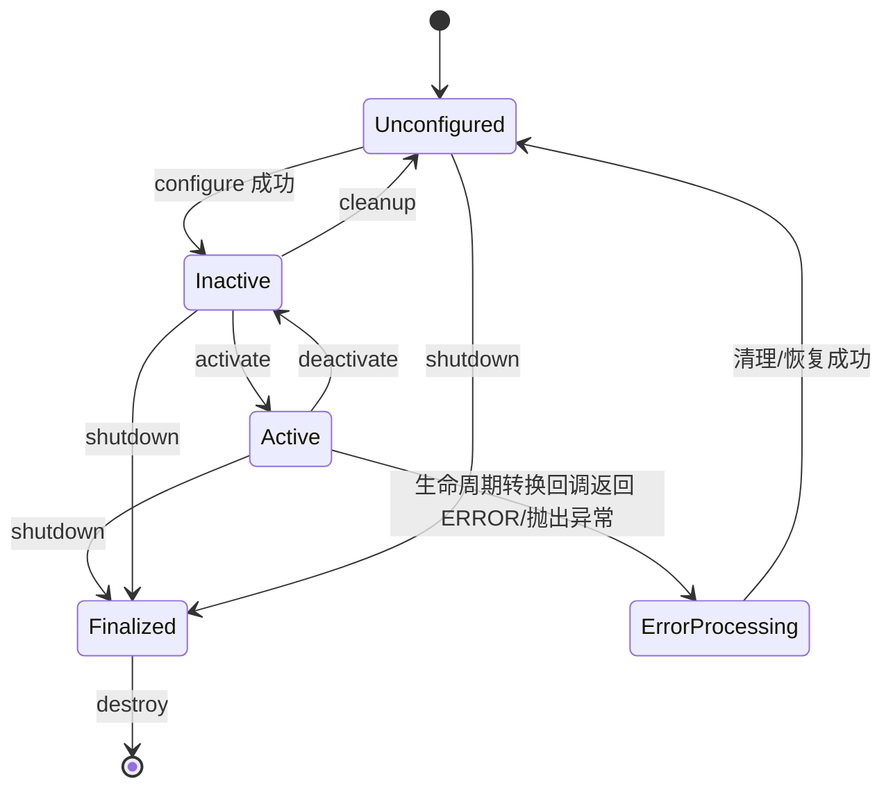
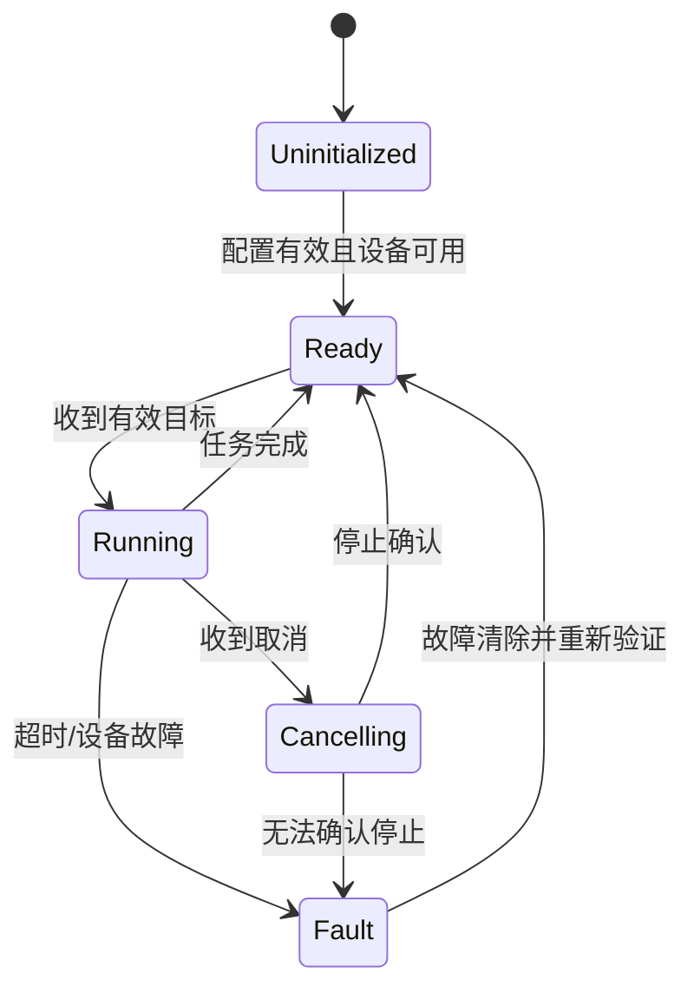

# 生命周期、状态机与行为树

“节点活着”“节点已配置”“功能可以工作”和“任务成功”是不同事实。将状态边界明确定义，才能让启动监督、错误恢复、取消和安全停机协同工作。

## 1. 三种状态层次不要混为一谈

1. **进程状态**：操作系统中程序是否运行、退出或崩溃。进程监控和重启策略处理这一层。
2. **ROS 2 managed-node 生命周期**：标准化单个节点从创建、配置、激活、停用到销毁的接口。它管理资源初始化和是否执行受管理的业务处理，不是应用 FSM 的替代品。
3. **应用状态/任务状态**：机器人是否空闲、执行某动作、等待设备、恢复或故障；某个任务是否被接受、运行、取消或完成。每个应用需根据自身业务定义。

ROS 1 没有与 ROS 2 managed nodes 等价的标准节点状态协议；ROS 1 工程可以自行实现状态 topic/service，也可以由 launch/监督器管理进程。不要在 ROS 1 代码里假设有 ROS 2 lifecycle service。

## 2. ROS 2 managed-node 生命周期

主要状态为 `Unconfigured`、`Inactive`、`Active`、`Finalized`，状态转换中还有 `Configuring`、`Activating`、`Deactivating`、`CleaningUp`、`ShuttingDown`、`ErrorProcessing` 等中间阶段。外部管理器可通过标准转换接口协调节点；节点在相应回调中建立或释放资源并报告转换结果。

生命周期设计规范把 `Inactive` 定义为不执行受管理的业务处理：受管理数据不应在此状态读取/处理，功能性请求不应作为可用服务来依赖，而生命周期管理接口仍须可用于管理节点。这是应用应实现的行为契约，并不意味着当前 `rclcpp_lifecycle` API 会自动停掉所有 ROS 实体。`LifecycleNode` 创建的 subscription、service 和 timer 回调仍可能由 executor 调用；被显式激活的 `LifecyclePublisher` 会按自身激活状态阻止发布，但订阅/服务/定时器需要节点实现自行停用、取消或在回调中检查状态并拒绝业务处理。部署在不同 ROS 发行版时，应核实相应实现。

消息在 inactive 期间是否保留，取决于 QoS；如果订阅仍在执行回调，应用还需显式决定是丢弃、缓存还是忽略消息。重新激活后可能收到新消息或 QoS 保留的数据，因此回调必须校验时间戳和有效期，不能把旧缓存当作新鲜输入。

常见回调职责：

- `on_configure`：读取并验证配置、创建长期存在的 publisher/subscription、分配缓冲和准备资源；尚不执行正常任务。
- `on_activate`：打开活动输出、显式激活 `LifecyclePublisher`，启动允许在 Active 工作的执行路径。
- `on_deactivate`：先停止产生工作/输出、显式停用 `LifecyclePublisher`，再释放仅在活动态使用的资源。
- `on_cleanup`：释放配置阶段资源，使节点可重新配置。
- `on_shutdown`：按允许的来源状态走完停止和资源清理。
- `on_error`：尝试受控恢复或安全清理，并报告是否可回到可配置状态。

状态回调要做有界、可失败的工作。`rclcpp_lifecycle` 通常在受管理的转换回调报告 `ERROR` 或抛出异常时进入 `ErrorProcessing`，再调用相应错误处理逻辑；普通 subscription/service/timer 回调里的业务错误不会自动变成生命周期转换。业务层必须显式报告故障、请求受控转换或通知监督器。设备初始化很慢时，管理器要观察转换超时和失败结果，不能把“调用服务成功返回”当成“硬件健康”。生命周期状态也不等于硬件安全保证；安全输出、超时和 watchdog 仍由控制/驱动层实现。

## 3. 应用有限状态机

有限状态机（FSM）适合状态与转换规则清楚、动作数量有限的流程。每个状态定义：进入动作、退出动作、周期更新、可接受事件和安全不变量。转换可表示为 `(当前状态, 事件, guard) → 新状态, action`。

例如一个与机器人业务无关的通用设备流程：

FSM 实施要点：

- 把状态枚举、事件和转换表集中管理；状态显示和控制逻辑不要各自维护一份状态。
- 明确 guard 的输入、数据新鲜度和缺失值行为。过期观测不可默认为安全通过。
- 将进入/退出副作用限制在单一状态所有者中，并记录转换原因；回调只投递事件或值对象。
- 规定重复事件、乱序响应、并发目标、超时和重入行为。
- 进入故障态时输出确定的安全意图；恢复要重新验证前置条件，不能只切回 `Ready` 字符串。
- 保持接口和运行时状态相容：新状态加入时更新状态发布、监控、测试和状态转换文档。

一个“状态新鲜度”设计可保存最后更新时间和有效期 `T_valid`，处理前检查 `0 ≤ now - t_sample ≤ T_valid`，同时拒绝不合理的未来时间戳。时钟源须一致，仿真时间启用时不能把墙上时钟和 ROS 时间直接比较。有关时间和时钟类型，见通信接口中的时间戳约定以及相邻数学/软件基础模块。

## 4. 行为树与跨模块任务编排

行为树（BT）用可组合节点描述较复杂的条件和动作。典型控制节点包括：

- **Sequence（序列）**：子节点按顺序运行；某子节点失败则序列失败，未完成则返回运行中。
- **Fallback/Selector（回退/选择）**：依次尝试子节点；某分支成功则完成，均失败才失败。
- **Parallel（并行）**：以并行语义执行若干子节点，需要定义成功/失败阈值和取消策略。
- **Decorator（装饰器）**：为子节点加条件、循环、超时或重试规则。
- **Action/Condition**：调用外部功能或读取条件，其接口需有明确返回和取消语义。

BT 适合表达高层任务顺序、条件分支、超时、恢复和可替换动作；底层高频反馈环应由专门控制器运行，BT 节点只下发任务、观察反馈并决定下一步。BT tick 频率、异步 action 生命周期、节点 halt 行为和动作服务取消需配置一致。一个树节点 halt 只表示编排器不再 tick 该子树，不必然等同于设备已停止。

Nav2 将 BT 用于组织导航任务与恢复流程，规划、控制和行为服务器则以独立接口/插件提供能力。这里仅说明软件编排模型；路径规划、代价地图、导航行为算法归[导航规划与代价地图](../导航规划与代价地图/分层代价地图与障碍生命周期.md)。

## 5. FSM、BT、Action 和生命周期的组合

- 生命周期控制“该节点当前是否配置好并允许提供功能”。
- FSM 控制某个设备或流程的唯一状态及安全转换。
- Action 暴露一个可反馈、可取消、可返回最终结果的任务接口。
- BT 或上层监督器编排多个任务，决定哪个 Action 先运行、何时重试或恢复。

例如，外部监督器先让节点从 Inactive 激活；BT 发送 Action goal；节点内部 FSM 检查状态、执行任务并发布反馈；收到取消后 FSM 进入 `Cancelling` 并等待驱动确认；最终 Action 返回 `Canceled` 或 `Aborted`。节点 deactivate 时，应停止接受新目标、按合同处理活动目标并保持驱动安全态。不同接口状态要一致，但不必拥有相同枚举。

## 6. 测试与故障诊断

最少验证正常转换、非法转换、重复事件、服务失败、超时、旧消息、取消竞争、故障恢复和退出。每项测试同时检查最终状态与副作用，例如输出是否停止、线程是否退出、资源是否释放。可在不启动硬件的单元测试中注入时钟、服务响应和设备结果，再用集成测试确认生命周期管理器和 ROS 接口行为。

诊断按层查看：节点当前生命周期状态；业务 FSM 当前状态和最近转换原因；Action goal 是否被接受/取消；BT 当前节点与返回状态；驱动/硬件反馈是否新鲜。若只看 `ros2 node list` 或进程列表，会把“存在”误判为“能用”。

## 参考资料

- [ROS 2 managed nodes design](https://design.ros2.org/articles/node_lifecycle.html)
- [rclcpp LifecyclePublisher implementation](https://github.com/ros2/rclcpp/blob/rolling/rclcpp_lifecycle/include/rclcpp_lifecycle/lifecycle_publisher.hpp)
- [rclcpp LifecycleNode implementation](https://github.com/ros2/rclcpp/blob/rolling/rclcpp_lifecycle/include/rclcpp_lifecycle/lifecycle_node.hpp)
- [ROS 2 managed-node documentation](https://github.com/ros2/ros2_documentation/blob/rolling/source/ROS-Framework/nodes/Working-with-nodes/Managed-Nodes.rst)
- [Nav2 behavior trees (Jazzy)](https://docs.nav2.org/jazzy/getting_started/nav2_behavior_trees/)
- [Nav2 navigation servers (Jazzy)](https://docs.nav2.org/jazzy/getting_started/navigation_concepts/navigation_servers/)
- [ROS 2 Actions](https://github.com/ros2/ros2_documentation/blob/rolling/source/ROS-Framework/interfaces/About-Actions.rst)
