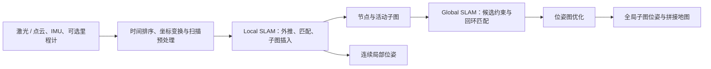

# SLAM 建模与 Cartographer 局部建图

SLAM（Simultaneous Localization and Mapping）要从运动测量和环境观测中同时估计机器人轨迹与地图。关键困难是两者互相依赖：定位需要地图，地图又需要位姿；传感器噪声和运动模型误差还会随时间积累。理解 SLAM 时，可以先写出估计问题，再沿数据流看每一类算法消除了什么误差、留下了什么不确定性。

## 从状态估计到地图

设机器人在时刻 $k$ 的状态为 $x_k$，运动测量为 $u_k$，环境中的路标或地图变量为 $m$，传感器观测为 $z_k$。一种常见的状态空间写法是：

$$x_k=f(x_{k-1},u_k,w_k),$$

$$z_k=h(x_k,m,v_k),$$

其中 $w_k$ 和 $v_k$ 分别表示过程噪声和观测噪声。轮速里程计、IMU、激光雷达和相机提供的测量不同，$f$ 与 $h$ 的形式也不同。单目视觉往往缺少绝对尺度；双目通过已知基线和视差恢复深度；深度相机直接测量距离，但测距误差仍随量程、材质和环境变化。激光测距则提供以传感器原点为起点的稀疏或稠密射线。

整个轨迹 $X=(x_0,\ldots,x_T)$ 与地图 $m$ 可用最大后验估计表达：

$$ (X^*,m^*)=\arg\max_{X,m}p(X,m\mid U,Z). $$

若噪声近似高斯，取负对数后常得到非线性最小二乘：

$$\min_{X,m}\sum_i \rho_i\!\left(\|r_i(X,m)\|_{\Omega_i}^2\right),$$

其中 $r_i$ 是运动或观测残差，$\Omega_i$ 是信息矩阵，$\rho_i$ 可用于抑制离群约束。滤波器按时间递推状态分布；图优化保留一段或全部状态，并用因子把不同时间的测量连接起来。两者都是估计方法，差别在于状态保留方式、线性化策略和计算成本，不能简单概括为“算力够就一定用优化”。最小二乘和鲁棒核的推导见[数学与信号基础](../数学与信号基础/README.md)。

里程计只把相邻时刻的相对运动串起来，误差会累积成漂移。后端需要新的几何约束来调整轨迹；回环检测负责提出“这片观测可能对应旧地图”的候选，随后仍需几何匹配和一致性检查。建图结果可以是稀疏路标、占据栅格、点云或拓扑关系，表达形式取决于定位和下游任务。

## Cartographer 的时间尺度与坐标系

Cartographer 将持续运行的局部估计和异步的全局修正分开：Local SLAM 处理时间相邻的测距数据，产生局部位姿并构建活动子图；Global SLAM 在后台把节点与子图建立约束，再优化它们的全局位姿。后端修正子图位姿后，系统可以重新拼接地图，而无需把全图的每个点重新积分。

用 $T_{A\leftarrow B}$ 表示把 $B$ 系坐标变换到 $A$ 系，坐标链满足 $T_{A\leftarrow C}=T_{A\leftarrow B}T_{B\leftarrow C}$。几个常见 frame 的职责如下：

| 坐标系 | 作用 | 是否会因后端优化跳变 |
| --- | --- | --- |
| `tracking` | 表达跟踪状态和传感器输入的参考刚体 | 安装关系由 TF 和外参决定 |
| `local map` | 表达连续 Local SLAM 结果 | 通常保持局部连续 |
| `submap` | 每张局部地图自己的参考系 | 子图完成后内部几何固定，活动子图仍可更新 |
| `global map` | 表达全局优化后的轨迹和子图 | 新约束加入后可改变相对 `local map` 的变换 |

所以回环后 `global map` 下的位姿可能变化，而 `local map` 下的短时运动仍连续。ROS 中的 frame 命名和 TF 所有权由系统配置决定；坐标系、外参及 TF 时间语义见[坐标变换与传感器标定](../坐标变换与传感器标定/坐标系、刚体变换与TF.md)。

## 从传感器数据到一次局部匹配

激光扫描不是同一瞬间采到的。若点 $p_i$ 的采样时刻为 $t_i$，可用运动预测把齐次点 $\tilde p_i=[p_i^T,1]^T$ 从当时的传感器系变换到统一参考时刻 $t_{ref}$：

$$\tilde p_{ref,i}=T_{tracking(t_{ref})\leftarrow tracking(t_i)}\,T_{tracking\leftarrow sensor}\,\tilde p_{sensor,i},\qquad p_{ref,i}=\operatorname{xyz}(\tilde p_{ref,i}).$$

这一步称为去畸变。它依赖时间戳、外参和运动预测都合理；时间偏移或错误外参会把静止墙面变成重影。传感器的时间、测量范围与噪声模型见[传感器与硬件通信](../传感器与硬件通信/README.md)，点云去畸变与时空同步由[点云处理与障碍检测](../点云处理与障碍检测/README.md)主讲。

典型的 2D 前端处理链如下：

1. 按时间顺序整理各传感器数据，等待预期输入，并依据点内时间对扫描去畸变。
2. 根据量程分开有效命中点（returns）和无回波/截断射线（misses）；空闲证据是否更新取决于输入类型和配置。
3. 将不同时间片累积到可匹配批次，转入重力对齐平面，并按高度范围裁剪。
4. 对插图数据和匹配点云进行空间降采样，控制栅格更新和优化成本。
5. 以位姿外推器给出的预测为初值，匹配当前扫描与活动子图。
6. 用匹配位姿更新下一时刻的外推器；若运动或时间变化足够大，才把扫描插入子图并生成后端节点。

预处理的几个阶段不能互相替代。固定体素过滤限制每个空间单元留下的数据量；自适应过滤在上限范围内调节体素尺度，以尽量达到目标点数。它们会减少计算，但不会从单一长墙中创造新的方向约束。Motion filter 判断是否插图和创建节点，不会撤销已完成的本次扫描匹配。

### 位姿外推与 IMU 的边界

位姿外推器要估计扫描采样期间传感器如何运动。令 $p_k$ 是时刻 $t_k$ 的位置、$v_k$ 是该时刻速度、$\tau=t-t_k$ 是时间间隔。短时间内，平移可用最近速度外推：

$$\hat p(t_k+\tau)=p_k+v_k\tau.$$

令单位四元数 $q_{WB}$ 表示从机体系 $B$ 到世界系 $W$ 的旋转，并采用标量在前的分量顺序。若 $\omega_B$ 是机体系角速度且在区间内近似恒定，定义 $\theta=\|\omega_B\|\Delta t$、$u=\omega_B/\|\omega_B\|$，右乘单位四元数增量：

$$\delta q_B=\left[\cos\frac{\theta}{2},\ u\sin\frac{\theta}{2}\right],\qquad q_{WB}(t+\Delta t)\approx q_{WB}(t)\otimes\delta q_B.$$

当 $\|\omega_B\|$ 接近零时令 $\delta q_B=[1,0,0,0]$；若角速度在世界系表达，则更新次序和乘法侧随约定改变。

加速度计的低通结果可用于估计重力方向，给 2D 匹配建立水平面；它不能直接等同于完整惯性导航，也不是简单把加速度双积分成位置。加速度还含机器人自身运动，陀螺积分的 yaw 会漂移；扫描匹配和全局约束仍然重要。一个预测器的具体输入优先级、插值和边界行为需按对应 Cartographer 版本及传感器接口核对。

## 前端的匹配、插图和地图表达

### 两类扫描匹配

相关性扫描匹配器在预测位姿附近离散搜索平移和旋转，使点落入较高占据概率的区域。它可弥补连续优化不擅长的大初值偏差，但候选数随平移窗口面积和角度采样数增加；走廊、重复房间可能出现多个相近高分解。匹配分数不是定位正确的概率。

Ceres 扫描匹配器则在当前位姿附近对地图残差和位姿先验做连续优化。一个简化的占据代价可写为：

$$r_i(\xi)=\frac{w_o}{\sqrt{N}}\,c(T_\xi p_i),\qquad c(x)=1-P_{map}(x),$$

$$\min_\xi \frac12\left(\sum_i r_i(\xi)^2+\|w_t(t-t_0)\|^2+|w_r(\theta-\theta_0)|^2\right).$$

按 $1/\sqrt{N}$ 缩放占据残差，使点云点数变化时其平方和更接近平均代价尺度；$w_o,w_t,w_r$ 乘在残差上，因此进入目标函数的系数是其平方。

地图插值使残差在格子之间可微；$t_0,\theta_0$ 是本次优化使用的先验/初始值。连续优化一般只能在初值附近改进，遇到错误对应或重复结构时可收敛到错误局部极小值。它不同于 ICP：ICP 显式建立点到点或点到面的对应关系，Cartographer 这种占据栅格扫描匹配直接从扫描点查询地图代价。两者的详细对比见[扫描匹配与点云配准](扫描匹配与点云配准.md)。

### 重叠子图

子图在局部参考系中累积一段连续扫描。常见 Cartographer 2D 工作方式会保留相邻的活动子图，并让同一扫描进入当前活动子图集合；一个子图达到设定的测距数据数后结束。相邻地图因此有重叠，可由共享节点把局部结构连接起来。子图结束后，其内部栅格内容固定，后端仍可优化子图的全局位姿。

“活动子图数量”“插图帧数”和墙钟时间不是同一量：批次累积、过滤策略和传感器频率都会改变一个子图覆盖的物理时间。较短子图更快冻结、约束更频繁；较长子图含更多数据但局部误差和计算负担也会累积。应按轨迹长度、几何变化和处理负载评估，不把某个模板中的计数当作普适常数。

### 概率栅格与 TSDF

概率占据图用 $P(occupied)$ 表示格子被障碍占据的信念。将概率变为 odds 和 log odds：

$$O(p)=\frac{p}{1-p},\qquad l(p)=\log O(p).$$

令 $p_z=P(m=\text{occupied}\mid z,p_0=0.5)$，即逆传感器模型在中性占据先验下给出的单次观测后验。若不同测量在给定格子真实状态后条件独立，log odds 证据可以累加：

$$l_{new}=l_{old}+\log\frac{p_z}{1-p_z},\qquad p_{new}=\frac{1}{1+e^{-l_{new}}}.$$

**教学示例：**从 $0.5$ 出发，两次使用 $p_z=0.55$ 的命中后验，得到约 $0.599$。这里的条件独立是假设不同观测在给定格子占据状态后相互独立；同一扫描中的相关回波会使此近似过于自信。实际系统常对概率设上下界，并限制同一批次重复写格子的次数；射线经过的格子表示空闲证据，端点表示命中证据。不同实现中 hit/miss 冲突处理和未知格评分可能不同，不能把更新公式与所有地图查询语义混为一谈。

TSDF（截断有符号距离场）融合到表面的有符号距离，例如以截断距离 $\mu$ 限制：

$$d=\operatorname{clamp}(r-r_{cell},-\mu,\mu).$$

它用加权平均更新格子的距离值，零水平集近似表面；这和“占据概率”不是同一量。TSDF 也不等同于供导航查询最近障碍距离的 ESDF。选择地图表示时要同时考虑插入模型、匹配代价和下游用途。

## 失败模式与学习检查

- 有扫描但没有局部结果：检查时间排序、必需传感器队列、TF 在消息时刻是否可查，以及点云是否为空。
- 静止墙面变厚：先核对时间戳、点内时间、传感器外参、运动预测与重力方向，再检查匹配初值。
- 局部地图一致但全局漂移不收敛：观察是否建立跨子图约束、候选分数是否越过门限，以及优化是否运行。
- 单次匹配分数很高但轨迹错误：重复走廊或对称结构会有多个相似解；需要多帧和其它观测验证。
- 回环后 `global map` 位姿变化：同时观察局部轨迹与 `global map` 到 `local map` 的变换，避免把全局修正误判成前端瞬时发散。

复现实验时，至少记录输入点数、去畸变前后位置、滤波后点数、预测与匹配的位姿差、匹配耗时、子图覆盖范围及后端约束。不要仅凭一张最终地图判断整条估计链路是否正确。

## 参考资料

- [Cartographer ROS 算法流程说明](https://github.com/cartographer-project/cartographer_ros/blob/master/docs/source/algo_walkthrough.rst)：Local SLAM、子图、节点约束和全局匹配的职责划分。
- [Cartographer 坐标系术语](https://google-cartographer.readthedocs.io/en/latest/terminology.html)：global/local map、submap 与 tracking frame 的定义。
- [Hess et al., Real-Time Loop Closure in 2D LIDAR SLAM, ICRA 2016](https://research.google/pubs/real-time-loop-closure-in-2d-lidar-slam/)：Cartographer 2D 分支定界扫描到子图匹配的论文背景。
