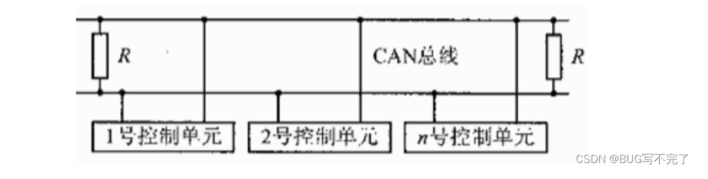

# CAN 与 SocketCAN

CAN 是一种多主机、按消息仲裁的串行总线。每个控制器都可在总线空闲时发起帧；多个节点同时开始发送时，硬件逐位仲裁，发送显性位的一方可继续，发送隐性位而读到显性位的节点退出本次仲裁。在相同帧格式下，数值较小的标识符通常有更高优先级，因为它较早发送显性位；标准帧和扩展帧的优先级比较涉及完整仲裁字段，不能只比较数值大小。协议层的帧标识符参与仲裁，并常被上层约定为消息类别和优先级。

## 总线帧和标识符

传统 CAN 有 11 位标准标识符和 29 位扩展标识符。CAN FD 保留兼容的标识符类型，可在仲裁阶段与数据阶段使用不同位速率，并把单帧有效载荷扩展到最多 64 字节；传统 CAN 数据帧最多 8 字节。SocketCAN 使用的帧结构还在标识符字段中放置扩展帧、远程帧和错误帧标志，不能把该字段直接当成纯设备地址。

CAN 总线在物理层是广播介质，没有像以太网 MAC 那样的逐节点地址。**CAN ID 不是固有的节点地址，也不表示帧只会发给某一个节点。** 系统协议可以约定“某类设备产生某个 ID”，或在有效载荷中另设设备号，但这属于上层编码。节点接收后通常按消息 ID 和掩码过滤自己关心的数据。[Linux SocketCAN 文档](https://docs.kernel.org/networking/can.html)

仲裁保证同一时刻总线上只保留一个胜出的帧，不保证更高层任务按截止时间完成。高优先级帧频繁占用总线会延迟低优先级帧；若两个节点持续发送相同标识符却载荷不同，错误可能直到仲裁字段之后才被发现。因此同一总线上的消息 ID 分配和发送周期需要整体设计。

物理接口还要求匹配控制器位时序、收发器、电缆拓扑和端接。高速差分总线通常只在物理总线两端按网络设计安装终端电阻；具体阻值、线长、支线和隔离要求以收发器与设备手册为准，软件配置不能补偿错误接线。位时序由同步段、传播段、相位缓冲段和采样点共同决定，不能只设置一个“波特率”就假设任意控制器之间必然互通。



图中电阻位于总线物理两端，中间节点通过支线接入；这是拓扑示意，支线长度和端接参数仍须按实际收发器设计核对。

## 链路校验不等于命令执行确认

CAN 帧包含 CRC、帧格式检查和 ACK 时隙等错误检测机制。ACK 表示至少一个能够正常接收的节点在链路层确认了正确帧；它不能证明特定目标应用已通过过滤、解码、执行命令或更新状态。发送 API 返回写入成功，也可能只意味着内核接口接受了该帧。

对重要命令，应用协议应定义序号、超时、心跳、状态读回或应用层响应，并区分：发送端未提交、总线错误、设备离线、消息序号跳变、命令被拒绝和命令已执行。CAN 控制器还会依据发送/接收错误情况进入 error-active、error-passive 或 bus-off 等状态；观察这些状态和错误帧有助于定位布线、位时序、接收端或负载问题。[Analog Devices CAN 实现指南](https://www.analog.com/en/resources/app-notes/an-1123.html)

## 从原始数据到测量值

CAN 的数据字节不是物理量本身。每个设备协议都需要定义 ID、帧类型、载荷长度、字段顺序、字节序、符号表示、比例系数、单位和周期。驱动的处理链可写为：

```text
CAN 帧 → 按 ID/类型分派 → 校验 DLC 与协议版本 → 解码字段
       → 应用符号扩展/比例/偏置 → 检查范围与时戳 → 更新状态或发布消息
```

电机或传感器的专用协议可能把角度、速度、电流、温度或状态位打包在同一帧中。不要从字段名猜单位；例如速度可能按 rpm、每秒计数或有符号定点值编码。增量编码器如何转换为角度和角速度见[传感器测量与时间戳](传感器测量与时间戳.md)；执行器命令与闭环映射由[机器人运动学与控制](../机器人运动学与控制/ROS控制器与实时数据流.md)主讲。

## Linux SocketCAN

SocketCAN 将 CAN 控制器呈现为 Linux 网络接口，并通过 `PF_CAN` 套接字向用户态提供统一接口。常见 `CAN_RAW` 用于逐帧收发和过滤；需要比单帧更大的应用消息时，应使用明确的上层传输协议，例如 ISO-TP，而不是把单帧载荷长度当作任意长度。

下面只显示 API 顺序，不是完整程序，未包含错误处理、文件描述符关闭、线程和接口配置：

```c
socket(PF_CAN, SOCK_RAW, CAN_RAW);
ioctl(fd, SIOCGIFINDEX, &interface_request);
bind(fd, (struct sockaddr *)&address, sizeof(address));
read(fd, &frame, sizeof(frame));
write(fd, &frame, sizeof(frame));
```

实际程序还应检查每个系统调用返回值、接口状态、读写长度、帧标志和数据长度；SocketCAN 的接收过滤器可按 ID 与 mask 设置。Linux 内核文档说明了 RAW 与 Broadcast Manager 套接字、CAN FD 选项、回环和错误帧接收等具体接口，字段名和支持范围应按目标内核头文件核对。

`can-utils` 是常用的 SocketCAN 用户态分析工具集：`candump` 可显示、过滤或记录帧，`cansend` 发送单帧，`canplayer` 回放日志，`cangen` 生成测试流，`cansequence` 检查递增序列，`canbusload` 估算总线负载。生成流和回放只验证软件接口，不证明真实设备接线和物理时序正确。[linux-can/can-utils](https://github.com/linux-can/can-utils)

## 接收线程与硬件驱动

内核网卡/控制器驱动处理控制器寄存器、中断和硬件收发；SocketCAN 用户程序负责应用层帧解码。若应用另建接收线程，它就是该程序自己管理的线程，不是 ROS executor 自动创建的回调线程。回调若直接在接收线程执行，耗时处理可能造成接收队列积压；可将短小的解码结果交给有明确容量和满队列策略的队列。线程退出时先停止接收并唤醒阻塞者，等待线程结束，再关闭套接字和释放回调引用资源。

采样时间应来自设备帧或硬件时间戳。若只能记录主机接收时刻，应将它标为接收时刻，并估计总线仲裁、驱动缓冲和调度延迟，不要声称它就是传感器采样时刻。

## 调试时逐层确认

1. 确认接口存在且已启动，位时序与设备一致。
2. 查看物理总线状态、发送/接收错误和 bus-off 计数。
3. 先用 `candump` 判断是否有目标 ID、帧类型和合理 DLC。
4. 核对 ID/掩码过滤，再检查序号是否连续、数据是否超范围。
5. 最后检查单位、偏置、坐标系和测量时间戳。

这能区分“接口没打开”“总线没有帧”“过滤器屏蔽了帧”“帧无法解码”和“数值语义错误”，避免先用滤波器掩盖通信问题。

## 参考资料

- [Linux Kernel：SocketCAN](https://docs.kernel.org/networking/can.html)
- [Analog Devices：CAN Implementation Guide](https://www.analog.com/en/resources/app-notes/an-1123.html)
- [linux-can/can-utils 用户态工具](https://github.com/linux-can/can-utils)
- [Renishaw：增量编码器、正交信号和基准点](https://www.renishaw.com/en/what-is-an-encoder--47256)
