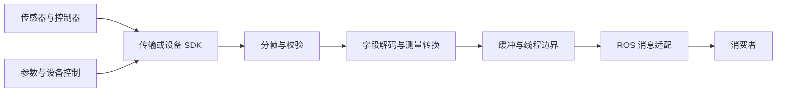

# 驱动数据流、消息与生命周期

驱动的职责是把可访问的设备数据转换成有明确接口语义的测量值。它既要处理通信和解析，也要对单位、时间、坐标、有效性与资源退出负责。一个好用的分层能让问题定位在具体阶段，而不是把所有故障都归到“传感器没数据”。

## 分层数据路径

可将实现职责分为：

1. **设备与传输层**：发现硬件、打开串口或网络端口、调用 SDK、接收字节或帧、发出配置命令。
2. **测量层**：分帧、校验、解码、单位换算、有效性检查、时间戳转换、必要的坐标处理。
3. **中间缓冲层**：在传输回调与耗时处理之间传递数据，定义容量、并发和丢弃策略。
4. **消息适配层**：将测量转成 ROS 接口，填写字段、时间戳、坐标帧、QoS 和诊断状态。

控制面用于配置、启停和查询设备状态；数据面承载连续图像、点云、惯性测量或距离读数。网络传感器可能有独立命令和数据端口；串口也可能在同一字节流里混合设备响应和主动上报。API 名称中的 `callback` 不说明它由 ROS executor 执行，厂商 SDK 可能在自己的接收线程调用用户代码。

若测量算法、硬件缓存或校准隐藏在 SDK/固件中，ROS 适配层只能保证自己传入了什么输入并发布了什么输出。除非有文档或实验依据，不应根据 `filter`、`sync` 等函数名宣称其内部实现。

## 驱动线程和资源的所有权

设备连接、SDK、串口描述符、缓冲区和接收线程应有明确所有者。常见启动顺序是：读取并校验配置 → 建立发布者和共享状态 → 注册回调 → 启动采集。否则首个异步回调可能访问尚未准备好的发布者或缓存。

退出时按相反依赖关系收尾：停止采集并阻止 SDK 再启动回调 → 按 SDK 契约注销回调 → 等待所有在途回调结束 → 通知并唤醒应用自建线程、等待线程退出 → 关闭连接 → 释放回调引用的缓存和 ROS 资源。若 SDK 将停采、注销和等待回调合并为一个接口，也要确认该接口返回时不会再启动新回调且已有回调已退出。分离线程（detached thread）如果仍持有节点、发布者或 buffer 的引用，仅有析构函数不能证明它会安全退出。若任务可能超过接收周期，测量回调只做短小、可界定的工作，其余交给容量受控的队列。

应用自己的 I/O 线程、SDK 回调线程、ROS executor 和 `ros2_control` 周期更新线程是不同执行实体；它们之间通过队列、互斥量、原子状态或同步接口传递数据。`volatile`、普通整数、互斥锁的存在或“单生产者”这一说法都不能单独证明整体线程安全。锁的范围应覆盖数据不变量，并避免持锁执行慢速串口读取、长时间滤波、磁盘写入或未知 SDK 调用。

`ros2_control` 将传感器、执行器或整机接口封装成硬件组件，并通过其 lifecycle 管理初始化、配置、激活、停用和清理。传感器类硬件通常在可用状态下提供状态接口；具有命令接口的组件还会接收输出命令。硬件状态句柄和命令句柄是接口抽象，不会自动提供电气保护或测量校验。具体回调签名需按目标 ROS 发行版查阅[硬件组件生命周期文档](https://control.ros.org/rolling/doc/ros2_control/hardware_interface/doc/lifecycle_of_a_hardware_component.html)。更广的组件、执行器和软件架构由[ROS 与软件架构](../ROS与软件架构/节点执行与组件化架构.md)主讲。

## 缓冲容量、数据新鲜度与背压

设平均输入速率为 $\lambda$ 帧/秒，平均处理速率为 $\mu$ 帧/秒，队列中有 $Q$ 帧。若长期 $\lambda>\mu$，任意有限容量队列最终都会满；增大容量只能吸收短时突发，同时可能增加数据年龄。

$$
\frac{dQ}{dt}\approx\lambda-\mu,
\qquad
T_{queue}\approx\frac{Q}{\mu}\quad(\mu>0).
$$

队列政策要符合数据类型：

| 数据 | 可能的策略 | 取舍 |
| --- | --- | --- |
| 连续状态流，消费者只需最新值 | 只保留最新一帧，或满时丢最旧帧 | 减少陈旧数据，但有意丢弃中间采样 |
| 事件、序列记录或需离线回放的数据 | FIFO，并对满队列报错或计数 | 保留顺序；背压和持续过载必须显式处理 |
| 多传感器同步数据 | 按时间戳和序号管理有限窗口 | 可配对时间邻近项，但需处理缺帧、乱序和过期 |

增加缓冲深度不等于提高吞吐，也不保证低延迟。至少分别记录接收数、解码失败数、队列满次数、丢弃数、发布数和最大数据年龄。定时器触发频率、SDK 自带缓冲、用户态队列和 ROS QoS 深度是不同层的容量，不能把其中一个的值当作总系统的丢帧保证。

## ROS 消息也是二进制协议

发布消息前要把字段契约写清楚：物理量、SI 单位、采样参考时刻、时钟域、坐标帧、有效范围和无效值表达。`header.frame_id` 只给坐标命名，不会把点旋转到别的坐标系；话题名区分数据流，也不会保证传感器身份或安装外参。

- `sensor_msgs/Imu` 的角速度用 rad/s、线加速度用 m/s²；协方差未知和该估计量不可用有不同表示。[消息定义](https://github.com/ros2/common_interfaces/blob/rolling/sensor_msgs/msg/Imu.msg)
- `sensor_msgs/Range` 是一个方向弧范围内的单次量程，不是二维扫描器消息；对固定阈值传感器，阈值内检测用 $-\infty$ 表示，无检测用 $+\infty$ 表示。连续量程传感器应按 `min_range`、`max_range` 和消息定义表达读数，不能把这些特殊值混用为模拟量程下限。[消息定义](https://github.com/ros2/common_interfaces/blob/rolling/sensor_msgs/msg/Range.msg)
- `sensor_msgs/LaserScan` 的角度和距离有单位与排列约定，扫描起始时刻与逐束时间间隔不能随意用发布时刻替代。
- `sensor_msgs/PointCloud2` 是字段表和二进制 data；要读取 `fields`、`offset`、`datatype`、`count`、`point_step`、`row_step`、字节序和组织方式，不要假设所有点都等同于内存中的某个 C++ 结构体。列举字段和组织方式见[接口定义](https://github.com/ros2/common_interfaces/blob/rolling/sensor_msgs/msg/PointCloud2.msg)。
- `sensor_msgs/Image` 还需检查 `encoding`、`step`、字节序和缓冲区大小；宽度乘通道数未必就是每行实际字节数。见[接口定义](https://github.com/ros2/common_interfaces/blob/rolling/sensor_msgs/msg/Image.msg)。

若点云从二维有序深度图压缩成只含有效点的一维数组，点索引便不再等于原像素索引。有效点判定应考虑 NaN、正负无穷、零值、深度范围和设备定义，而不是只看单一分量；`is_dense` 也要与实际无效值处理一致。

共享内存、借用消息或 loaned message 不自动等于整条数据通路零复制。SDK 缓冲归还、序列化、RMW 实现和发布方式都影响拷贝次数及生命周期；消费者应只读取消息声明范围内的数据。

## 设备身份、路径与坐标

稳定的设备身份映射应覆盖硬件序列号或端口 → 操作系统设备路径 → 驱动实例 → ROS 话题 → 坐标帧。路径 `/dev/ttyUSB0` 可能因枚举顺序变化；`udev` 规则可按子系统、父设备属性、序列号等生成符号链接或设置权限。[udev 规则手册](https://www.freedesktop.org/software/systemd/man/261/udev.html)

udev symlink 有助于找到设备，但不证明它是哪个物理传感器，也不提供坐标变换；访问权限合适不等于串口波特率或协议正确。多个相同型号设备时优先用唯一序列号、物理 USB 端口或经验证的拓扑识别，再通过观测响应核对映射。网络设备也要分清目标设备地址、主机数据监听端口和控制端口。

设备身份、话题命名、`frame_id` 和 TF 各自解决不同问题：身份确定数据来自哪个设备，话题路由数据，`frame_id` 标记测量坐标系，TF 提供时变或固定的坐标关系。外参和 TF 的变换推导见[坐标变换与传感器标定](../坐标变换与传感器标定/坐标系、刚体变换与TF.md)。

## 质量检查与诊断顺序

先沿数据路径检查，再决定是否需要滤波：

1. **设备层**：设备是否存在、供电和接口是否正常、身份是否稳定。
2. **传输层**：串口/网络/CAN/EtherCAT 是否连通，有无超时、错误计数、序号缺口。
3. **解析层**：长度、类型、校验、单位、符号扩展和版本是否正确。
4. **测量层**：时间戳基准、有效范围、偏置、尺度、饱和与坐标是否合理。
5. **ROS 层**：话题、QoS、消息类型、字段布局、frame_id、时间戳和消费者假设是否一致。

开串口成功不代表收到正确协议；收到了帧不代表 CRC 通过；CRC 通过不代表设备数据在有效量程；发布频率正常也不代表数据新鲜。有效读数、无效读数、没有新消息和最后读数已过期应保留为不同状态。

## 参考资料

- [ros2_control：硬件组件生命周期（Rolling）](https://control.ros.org/rolling/doc/ros2_control/hardware_interface/doc/lifecycle_of_a_hardware_component.html)
- [ROS 2 `sensor_msgs/Imu`](https://github.com/ros2/common_interfaces/blob/rolling/sensor_msgs/msg/Imu.msg)
- [ROS 2 `sensor_msgs/Range`](https://github.com/ros2/common_interfaces/blob/rolling/sensor_msgs/msg/Range.msg)
- [ROS 2 `sensor_msgs/PointCloud2`](https://github.com/ros2/common_interfaces/blob/rolling/sensor_msgs/msg/PointCloud2.msg)
- [ROS 2 `sensor_msgs/Image`](https://github.com/ros2/common_interfaces/blob/rolling/sensor_msgs/msg/Image.msg)
- [systemd `udev` 规则](https://www.freedesktop.org/software/systemd/man/261/udev.html)
