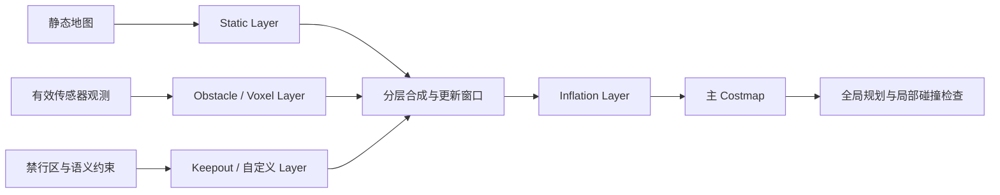

# 分层代价地图与障碍生命周期

代价地图把静态地图、实时传感器证据、人工禁行区域和安全距离放进统一的二维栅格，供全局规划器、局部控制器和碰撞检查共同使用。它记录的是导航决策所需的空间代价，不是完整的三维场景，也不等同于占据概率图。

本文从栅格值、图层更新和障碍证据生命周期讲起。传感器如何形成地面与障碍的几何观测，由[点云处理与障碍检测](../点云处理与障碍检测/README.md)主讲；这里重点讨论一旦证据进入 costmap，如何标记、清除、保留和衰减。

## 1. 栅格坐标与代价值

设地图分辨率为 $r$ 米/格，世界坐标原点为 $(o_x,o_y)$。世界位置 $(x,y)$ 映射到栅格索引：

$$
i=\left\lfloor\frac{x-o_x}{r}\right\rfloor,\qquad
j=\left\lfloor\frac{y-o_y}{r}\right\rfloor.
$$

第 $(i,j)$ 格的中心位置为 $x=o_x+(i+0.5)r$、$y=o_y+(j+0.5)r$。一个格子代表一块面积而非一个无尺寸点，因此分辨率会影响窄障碍是否命中、通道是否连通以及边界误差。地图面积不变时，格子数大致与 $1/r^2$ 成正比；分辨率减半，格数约增至四倍。

若栅格宽、高分别为 $n_x,n_y$，合法索引必须满足 $0\le i<n_x$、$0\le j<n_y$。世界坐标落在地图范围外时，调用方需要明确返回“地图外”或执行相应失败策略；将索引静默夹到最近边界格会把地图外的位置误判为已知障碍/自由格。

Nav2 `nav2_costmap_2d` 的内部代价通常按以下字节值表达：

| 内部值 | 名称 | 含义 |
| ---: | --- | --- |
| 0 | `FREE_SPACE` | 已知自由空间 |
| 1–252 | 中间代价 | 软偏好或距离代价，由规划器和控制器解释 |
| 253 | `INSCRIBED_INFLATED_OBSTACLE` | 机器人内切半径内的高代价 |
| 254 | `LETHAL_OBSTACLE` | 致命障碍 |
| 255 | `NO_INFORMATION` | 未知空间 |

这组值是 costmap 内部语义。发布为 `OccupancyGrid` 时可能转换到另一套取值，所以 RViz 中看到的占据值不一定等于内部字节。未知 255 也不能当作普通“比 254 更大的障碍”来做无条件最大值合并；保留、覆盖或禁止穿越未知区都需要明确策略。

## 2. 图层如何重建主地图

分层 costmap 通常由若干插件构成。静态层提供基础地图；障碍层或体素层加入传感器观测；膨胀层把硬障碍周围转换为安全距离代价；禁行区或语义层可以补充人为约束。插件列表决定哪些图层实际参与更新，配置块中单独写着 `enabled: true` 并不能加载一个没有列入列表的插件。

更新通常分为“确定区域”和“写入代价”两阶段：

1. 各图层的 `updateBounds()` 报告本轮可能变化的世界坐标范围。
2. costmap 管理器把这些范围合并，并裁剪成栅格更新窗口。
3. 框架重建该窗口中的主地图内容。
4. 按图层顺序调用 `updateCosts()`，把各层代价合入主地图。
5. 规划器或控制器在后续循环中读取合成结果。

图层可以维护自己的栅格或稀疏对象，也可能直接写入主地图；具体合并方法决定后层能否覆盖前层。常见策略包含最大值合并、覆盖和加和。使用 `updateWithMax()` 时还必须理解未知值的特殊处理，不能直接把它等同于 `std::max()`。

更新窗口必须包含旧值可能需要消失的位置。若一面移动的虚拟墙只上报新位置，旧位置不在重建窗口内，就可能留下残影。图层实现删除或移动对象时，应把旧、新包围盒都标成 dirty 区域；滚动栅格则要在世界坐标下维护证据，并在窗口移动后重新投影。

## 3. 静态地图、局部窗口与动态证据

静态层把已有占据地图映射成基础代价。地图中的“未知”“自由”“占据”如何映射，受未知空间策略、占据阈值和是否保留连续代价影响。静态层不应被看成传感器实时观测：机器人刚从某处驶过，并不意味着静态墙会因当前扫描没有回波而自动消失。

全局 costmap 常用于从起点到目标的全局路径搜索，地图范围较大，可能以静态地图为基础并叠加动态障碍。局部 costmap 常用于短时避障和控制，覆盖机器人附近的有限区域，并可采用滚动窗口。`map` 作为全局参考系、`odom` 作为局部参考系是常见搭配，不是每个系统的硬性规定。两张地图的数据只有在时间戳、坐标变换、机器人 footprint 和更新频率相容时才可比较。

`update_frequency` 决定计算地图的频率；`publish_frequency` 决定发布可视化或消息的频率。发布得慢不必然意味着控制器读到的地图更新慢，反之亦然。调节分辨率、窗口尺寸或图层数时，应同时观察更新耗时和最大更新范围。

## 4. 障碍层的 marking 与 clearing

对一个有效测距观测，设传感器原点为 $s$，回波端点为 $p$。**Marking** 可把通过高度和距离过滤的端点写成障碍；**clearing** 则沿 $s$ 到 $p$ 的可见射线清除穿过的旧障碍格。射线遍历常使用 Bresenham 一类离散网格算法。

二者是两种不同的证据：

- 一个端点命中可以提供“此处有障碍”的证据。
- 只有可信的可见射线才能提供“传感器到这里看起来是空的”证据。
- 无效测量、遮挡、吸光材质或超量程都可能导致没有有效端点；没有回波不能一概解释为自由空间。
- 标记距离和清除距离可以不同，且应分别匹配传感器量程与视场。

这也是为什么将多个来源拼成一条合成扫描后，不能不加区分地对其开启 raytrace 清除：合成的远点可能表示边界或虚拟点，而不是传感器真实观测到的自由射线。障碍层的观测消息缓冲时长也不等价于“每个障碍格的寿命”。

## 5. 三维体素与二维导航投影

体素层在 $(x,y,z)$ 上离散化观测。若水平分辨率为 $r$，垂直分辨率为 $r_z$，体素索引可写为：

$$
(i,j,k)=\left(\left\lfloor\frac{x-o_x}{r}\right\rfloor,
\left\lfloor\frac{y-o_y}{r}\right\rfloor,
\left\lfloor\frac{z-o_z}{r_z}\right\rfloor\right).
$$

每个水平柱可记录一组未知、自由和占据体素，再按占据数量阈值投影为二维代价。三维射线可以表达观测从障碍上方穿过的事实，从而避免压平后误清更低处的结构；但压平图仍无法保留完整高度形状。体素过粗可能抹掉细柱，过细会增加内存、噪声和更新开销。具体体素阈值与最大层数是插件参数，不能把某个插件的参数套到另一个插件上。

点云的地面拟合、地面高度窗和物体几何分类属于观测处理；进入二维地图后，栅格值表达的是导航用途。若障碍在压平后消失，应先检查高度过滤、投影阈值和清除射线，再调整规划器。

## 6. 障碍记忆、衰减与近区冻结

动态地图需要定义障碍证据如何过期。常见状态至少包含障碍位置、最近命中时间、有效可见清除次数和来源通道。再次命中通常刷新 `last_seen`；清除需有通过校验的自由空间证据；时间衰减则根据 `now - last_seen` 判断是否遗忘。

一个通用的寿命判定可以表达为：

$$
\text{expire}(q,t)=
\bigl(t-t_{\text{last}}(q)>T_q\bigr)
\lor
\bigl(n_{\text{clear}}(q)\ge N_q\bigr),
$$

其中 $T_q$ 是该类证据的 TTL，$N_q$ 是可信清除证据的门限。这个模型用于说明策略，不代表 Nav2 所有障碍层都有逐点 TTL。不同图层可能按观测缓冲、整层重置、可见性衰减或自定义记忆实现；必须按实际插件实现确认。若地图有局部可见性估计，视场内外可以使用不同的衰减速率，但“处在视场内”本身仍要由可靠传感器模型判定。

近车身冻结区是某些自定义图层采用的保守策略：障碍一旦进入车体附近盲区，短时冻结它的清除或 TTL 计时，避免机器人因失去视线就把仍在车旁的障碍误删。冻结不是标准 Nav2 ObstacleLayer 的通用开关，也不应停止接收新障碍；它只影响特定图层中已有证据的淘汰逻辑。离开冻结区后的寿命策略是实现选择：可以暂停后续计时并恢复累计年龄、从离区时重新计 TTL，或要求新的可见清除证据。应在图层语义中明确选一种，并用遮挡/离区场景验证。

若正障碍和负障碍由上游模块分别提供，它们可以有不同的保留时限，但都要保留来源和证据类型。负障碍的物理检测与自由落差判定见[点云处理与障碍检测](../点云处理与障碍检测/README.md)，本篇只讨论其进入地图后的标记和清除生命周期。

## 7. 膨胀层：硬障碍周围的距离场

障碍端点只占少数格子，膨胀层以到最近障碍的距离 $d$ 生成一圈硬安全区和外侧软代价。典型 Nav2 指数衰减可概括为：

$$
C(d)=\begin{cases}
254,&d=0,\\
253,&0<d\le r_i,\\
\left\lfloor252\exp[-k(d-r_i)]\right\rfloor,&r_i<d\le R,\\
0,&d>R,
\end{cases}
$$

其中 $r_i$ 是 footprint 的内切半径，$R$ 是膨胀半径，$k$ 是衰减系数。实现会先按格距离查表，再乘地图分辨率换成米。超出 $R$ 表示这一层不再贡献额外膨胀代价，不是把底图强制清零。未知空间是否膨胀由单独选项决定。

这个分段表达假设 $R\ge r_i$，即膨胀范围至少覆盖内切半径。若配置的膨胀半径小于内切半径，距离代价会在进入内切区之前被范围截断，不能依靠该图层提供完整的内切安全代价，应核对当前插件的行为。

数值示例：若 $r_i=0.25\,\text{m}$、$d=0.30\,\text{m}$、$k=3\,\text{m}^{-1}$，未取整的软代价为 $252e^{-0.15}\approx216.90$，转换为整数代价后向下取整为 216。此处仅用于演示公式。增大 $k$ 会令曲线更快衰减；增大 $R$ 会扩大软代价影响范围，但不改变给定距离处的指数衰减率。

膨胀是距离偏好，不是任意朝向多边形 footprint 的完整碰撞检查。内切圆之外的软代价格可能仍与车头或车尾相交。足迹碰撞模型、地图分辨率和最小安全距离应一起校准；不要把圆形安全半径、规划器代价权重和膨胀距离当成同一个量。

## 8. 虚拟墙、禁区与栅格边界

人工几何可表达固定禁区、临时封路或低优先级区域。常见形状包括圆、线段胶囊和多边形。点 $p$ 到线段 $a\to b$ 的最近点由下式求得：

$$
t=\operatorname{clamp}\!\left(\frac{(p-a)^T(b-a)}{\|b-a\|^2},0,1\right),\qquad
q=a+t(b-a),\qquad \|p-q\|\le w.
$$

这里 $w$ 是线段的半宽；端点自然形成圆头。若 $a=b$，投影分母为零，应把退化线段按以 $a$ 为圆心、半径 $w$ 的圆处理。多边形内部可用奇偶射线法判断，但自交轮廓、边界点归属和孔洞需要明确约定。

若只测试每个格子的中心点，窄于分辨率的禁区可能没有格中心落入其中。对安全约束更稳妥的栅格化方式是测试“格子面积与形状是否相交”，或先把形状按车体半径和量化误差保守扩张。删除或移动形状时，还要将旧范围和新范围加入更新窗口，否则图层数据删了，主地图旧格可能仍在。

人工偏好代价与硬禁行也应区分：例如中间代价只表示“不优先走这里”，不保证控制器会绝对避开；致命障碍与未知值还受主地图合并策略及规划器未知区选项影响。Nav2 的 Keepout Filter 提供基于过滤掩码的禁行区方案；自定义图层也可以按所需几何和更新机制实现，但需要单独验证对未知格、路径检查和生命周期的处理。

## 9. 版本边界与故障排查

ROS 1 `move_base` 与 ROS 2 Nav2 都有分层 costmap、障碍观测和膨胀这些概念；Nav2 将规划器、控制器和 costmap 组织为服务器与插件，生命周期、参数结构和插件类型写法会随发行版变化。ROS 1 教程有助于理解数据流，不能把旧 YAML 或 C++ 插件名原样当成当前 Nav2 配置。

排查“地图看得见但行为不对”时，按证据链逐项检查：

1. 实际加载的插件列表、实例 ID 与本次 Action 请求是否匹配。
2. 输入话题是否真的进入该层，消息类型、QoS、frame 和时间戳是否有效。
3. 标记和清除是否由同一类可信观测驱动；清除范围是否覆盖旧障碍。
4. 旧格是否进入了更新窗口，图层组合顺序是否让后层覆盖前层。
5. 未知空间、footprint、膨胀区和规划器的碰撞规则是否一致。
6. 区分更新计算频率、发布频率、TF 可用率和传感器数据年龄。

## 参考资料

- [Nav2 Costmap 2D 配置指南](https://docs.nav2.org/rolling/configuration_and_development/configuration_guide/core_servers/costmap_2d/)：图层配置、主地图参数、插件组合与全局/局部窗口示例。
- [Nav2 Obstacle Layer 参数](https://docs.nav2.org/jazzy/configuration_and_development/configuration_guide/core_servers/costmap_2d/costmap_plugins/obstacle/)：marking、clearing、射线范围和高度过滤。
- [Nav2 Inflation Layer 参数](https://docs.nav2.org/rolling/configuration_and_development/configuration_guide/core_servers/costmap_2d/costmap_plugins/inflation/)：指数衰减、footprint 内切半径和未知空间选项。
- [Nav2 Costmap2D 插件教程](https://docs.nav2.org/rolling/tutorials/plugin_tutorials/writing_new_costmap2d_plugin/writing_new_costmap2d_plugin/)：`updateBounds()` 与 `updateCosts()` 的插件接口职责。
- [Nav2 环境表示](https://docs.nav2.org/rolling/getting_started/navigation_concepts/environmental_representation/)：costmap 作为规划与控制共享空间表示的基本概念。
- [Nav2 Mapping and Localization](https://docs.nav2.org/rolling/configuration_and_development/first_time_robot_setup_guide/sensors/mapping_localization/)：ROS 1 costmap 到 Nav2 的迁移背景与常见图层概念。
- [Nav2 costmap 内部代价值定义](https://github.com/ros-navigation/navigation2/blob/main/nav2_costmap_2d/include/nav2_costmap_2d/cost_values.hpp) 与 [InflationLayer 代码](https://github.com/ros-navigation/navigation2/blob/main/nav2_costmap_2d/include/nav2_costmap_2d/inflation_layer.hpp)：核对内部编码和距离代价实现。
