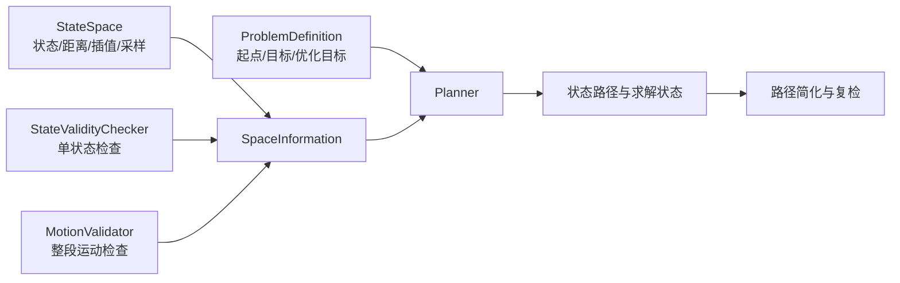

# 采样规划与 OMPL

网格搜索把空间离散成有限节点；在高维、带朝向或含关节自由度的配置空间里，完整栅格可能大到无法直接搜索。采样规划器改为随机或有偏地采样状态，再连接一部分局部运动。OMPL（Open Motion Planning Library）提供这些算法及问题描述接口，但不会自动读取 ROS 话题、代价地图或机器人模型。

本文重点是几何采样规划及其有效性边界。costmap 障碍的语义见[分层代价地图与障碍生命周期](分层代价地图与障碍生命周期.md)；运动学和动态控制模型见[机器人运动学与控制](../机器人运动学与控制/README.md)。

## 1. 把规划问题交给库

规划器需要知道“有哪些状态、如何从一个状态走到另一个状态、什么状态有效、目标是什么、如何比较路径”。OMPL 把这些职责拆分为可组合对象：

### StateSpace

`StateSpace` 定义状态维度、合法范围、距离函数、采样和插值。平面位姿可写作 $(x,y,\theta)$，但朝向是周期量：

$$
\Delta\theta=\operatorname{wrap}(\theta_2-\theta_1),\qquad
d(q_1,q_2)=\sqrt{(x_2-x_1)^2+(y_2-y_1)^2+w_\theta^2\Delta\theta^2}.
$$

这里 $w_\theta$ 表示朝向对距离的权重，需要按任务定义。若直接把 $\theta$ 当普通实数，$179^\circ$ 到 $-179^\circ$ 会被错误地认为相差 $358^\circ$。状态距离还会影响最近邻、扩展距离和路径代价。

### 状态有效性与运动有效性

`StateValidityChecker` 判断一个状态是否允许，例如机器人在此位姿下 footprint 不碰障碍。`MotionValidator` 判断从状态 $q_a$ 到 $q_b$ 的整段插值运动是否有效。两个端点单独有效，仍不能证明中间没有穿过薄墙。

默认离散运动验证会按 StateSpace 计算的段数采样中间状态；采样分辨率由状态空间的有效线段长度设置推导，不是直接以“米”填写的碰撞距离。检查间隔太稀可能漏掉薄障碍，过密会显著增加碰撞查询成本。需要时可提供更保守的运动验证器或连续碰撞检测。

如果 planner 可并发检查状态或运动，checker、地图快照与底层碰撞结构也必须线程安全。一次 solve 期间地图若实时变化，路径前后段可能基于不同环境版本；集成层应固定快照或让变更明确地取消/重启查询。

### 几何规划和控制规划

几何规划器返回一串状态及局部连接段，通常只对几何碰撞负责；它不自动满足速度、加速度或时间约束。控制规划器则需要控制空间、状态传播器和动力学模型，沿可执行控制输入推进状态。给几何路径重新加时间参数不一定使其满足动力学可行性，仍应由轨迹生成或控制模块验证。

## 2. PRM：先建图，再查询

Probabilistic Roadmap (PRM) 面向可复用路线图。基本流程为：

1. 在配置空间中采样若干有效状态，作为顶点。
2. 按距离选择邻近顶点，尝试用局部连接器连接。
3. 只有局部运动通过 `MotionValidator` 才保留图边。
4. 查询时把起点、目标接入路线图，在图上执行搜索。

PRM 的价值是多次查询可以摊销同一张静态路线图的构建成本。瓶颈是窄通道体积小，均匀随机采样很难落入；连接太稀可能断图，连接太密会增加碰撞检查和图搜索成本。

普通 PRM 不等同于 PRM*。PRM* 随路线图增长调整连接邻域，在理论条件下具有渐近最优性质；不能把这项保证套给任意 PRM 配置。若环境动态变化，已有路线图的旧边可能穿过新障碍，必须重验证边或使相关边失效。

## 3. RRT：向随机状态扩展树

Rapidly-exploring Random Tree (RRT) 适合单次起终点查询。每轮生成采样状态 $q_{rand}$，找树中最近状态 $q_{near}$，再把扩展距离限制在 $\eta$ 内：

$$
q_{new}=\operatorname{interpolate}\left(q_{near},q_{rand},
\min\left(1,\frac{\eta}{d(q_{near},q_{rand})}\right)\right).
$$

如果 $q_{near}\to q_{new}$ 通过运动有效性检查，就把新状态和父边加入树。近邻状态的 Voronoi 区域带来对空白区域的探索偏置。采样器可以以一定概率偏向目标，但目标偏置太高会削弱绕障探索。

RRT 的目标是较快找到可行路径，不会不断为更短路径重连树。它的 `range` 限制单次新边长度；这不是碰撞检测步长。缩小 `range` 无法修复过稀的 `MotionValidator`。

## 4. RRT-Connect：双向树快速接合

RRT-Connect 从起点和目标各自生长一棵树。一棵树先向采样状态 `EXTEND`，取得进展后，另一棵树向新状态连续 `CONNECT`，直到接上、被障碍困住或只取得部分进展。双向扩展常能较快获得初始可行解，适用于多类静态几何问题。

RRT-Connect 不是最优重连算法；第一次返回的路径可能有较大绕行和折角。对有方向或不可逆的系统，目标树反向扩展时的局部动作未必能反向执行。平滑路径后要对完整运动段重新碰撞检查，并由控制器确认方向、曲率与动态约束。

## 5. RRT*：选择父节点并重连

RRT* 在接入新状态后，从其邻域中选择累计目标代价最小的有效父节点：

$$
q_{parent}=\arg\min_{p\in\mathcal N(q_{new}),\;\text{motion}(p,q_{new})\text{ valid}}
\left[g(p)+c(p,q_{new})\right].
$$

之后尝试把邻居 $v$ 改接到 $q_{new}$。若

$$
g(q_{new})+c(q_{new},v)<g(v)
$$

且运动有效，就重连并更新该节点后代的累计代价。常见理论邻域半径随样本数 $n$ 变化，量级为

$$
r_n=\min\left(\eta,\gamma\left(\frac{\log n}{n}\right)^{1/d}\right),
$$

其中 $d$ 是空间维数，$\gamma$ 与可行空间、度量等条件有关；也可使用 k-nearest 邻域。该式说明邻域如何随样本增多而收缩，不是可以对所有机器人直接照抄的固定调参公式。

RRT* 在标准假设下对指定的 `OptimizationObjective` 渐近趋近最优，不意味着有限时间必得最优解。首次找到解可能慢于 RRT-Connect。默认优化目标若只看路径长度，最短路径不必然离障碍最远、耗时最短或能耗最低；“更优”由目标函数定义。碰撞模型错误时，规划器可能更高效地逼近一条不安全的最优路径。

## 6. 如何接入代价地图与判断保证

将 OMPL 用在二维导航时，集成层至少要完成：

- 把 costmap 的坐标、分辨率、未知值和障碍阈值转换为碰撞查询。
- 使用实际 footprint 和朝向构造 `StateValidityChecker`。
- 为局部连接定义正确插值，并让 `MotionValidator` 检查整段而非仅端点。
- 设定空间 bounds、距离权重、目标容差和停止条件。
- 将结果路径转换为下游导航消息，同时复检平滑、插值或时间参数化后的路径。
- 在查询过程中保证 costmap 快照一致，并遵守 checker 的线程安全要求。

成功状态也有区别：严格到达目标的解与预算内最接近目标的近似解不能当成一回事。随机规划实验还应固定问题和碰撞分辨率，使用多个随机种子，分别报告首次解时间、最终代价、碰撞验证次数和失败比例；一次成功不能证明参数普遍更好。

| 算法 | 主要数据结构 | 典型用途 | 不能单独保证 |
| --- | --- | --- | --- |
| PRM | 多查询图 | 环境较稳定、反复查询 | 普通 PRM 的渐近最优性、动态环境旧边安全 |
| RRT | 单向树 | 单次查询、快速探索 | 最短路径或平滑性 |
| RRT-Connect | 起点和目标两棵树 | 尽快找到可行路径 | 路径最优、反向边可执行 |
| RRT* | 带重连树 | 在预算内持续改进代价 | 有限时间最优、目标函数之外的安全属性 |

## 参考资料

- [OMPL Primer](https://ompl.kavrakilab.org/OMPL_Primer.pdf)：状态空间、问题定义、运动有效性与规划器组织。
- [OMPL State Validity Checking](https://ompl.kavrakilab.org/stateValidation.html)：状态检查、离散运动检查和线程安全要求。
- [OMPL Available Planners](https://ompl.kavrakilab.org/planners.html)：PRM/PRM* 与 RRT/RRT-Connect/RRT* 算法分类。
- OMPL [PRM 类参考](https://ompl.kavrakilab.org/classompl_1_1geometric_1_1PRM.html)、[RRT-Connect 类参考](https://ompl.kavrakilab.org/classompl_1_1geometric_1_1RRTConnect.html) 与 [RRT* 类参考](https://ompl.kavrakilab.org/classompl_1_1geometric_1_1RRTstar.html)：核对接口概念、算法描述和配置项。
- Kavraki et al., [“Probabilistic Roadmaps for Path Planning in High-Dimensional Configuration Spaces”](https://doi.org/10.1109/70.508439), 1996。
- Kuffner and LaValle, [“RRT-Connect: An Efficient Approach to Single-Query Path Planning”](https://doi.org/10.1109/ROBOT.2000.844730), 2000。
- Karaman and Frazzoli, [“Sampling-based Algorithms for Optimal Motion Planning”](https://arxiv.org/abs/1105.1186), 2011。
