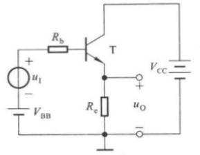

# BJT 放大与工作点分析

双极型晶体管（BJT）由发射区、基区和集电区构成。发射区通常重掺杂，以注入较多载流子；基区薄且掺杂较轻，以减少注入载流子的复合；集电区负责收集载流子并承受电压、耗散功率。NPN 与 PNP 的端子和分析规律相同，偏置极性与电流方向相反。

## 端子、箭头与工作区

电路符号中的箭头位于发射极，按**传统电流方向**标记发射结的正向方向：NPN 箭头向外，PNP 箭头向内。不要把箭头误读成电子运动方向。

以 NPN 为例，处于正向有源区时，基极—发射极结正向偏置，集电极—基极结反向偏置。电子主要从发射区注入基区，其中一小部分在基区复合并形成基极电流，大部分被集电结电场收集到集电区。传统电流则从集电极流向发射极。忽略漏电时，端电流的大小满足

$$
I_E = I_C + I_B, \qquad I_C \approx \beta I_B
$$

$\beta$ 是特定器件在特定电流、温度和集电极电压下的电流增益，不是精确不变的常数。实际偏置不能只凭“常用 $\beta$”确定，设计还要考虑器件离散、温度和负载变化。PNP 有源区的电压极性和传统电流方向与 NPN 相反，电流大小关系仍成立。

| 工作区 | 基极—发射极结 | 集电极—基极结 | 常见用途 |
|---|---|---|---|
| 截止 | 未正向导通 | 反向偏置 | 作为关断开关；仍有漏电 |
| 正向有源 | 正向偏置 | 反向偏置 | 线性放大 |
| 饱和 | 正向偏置 | 也正向偏置 | 作为导通开关；$I_C=\beta I_B$ 不再适用 |

## 共射放大与静态工作点

共射电路把发射极作为输入和输出的交流公共端：输入小信号 $v_i=v_{be}$ 加在基极—发射极间，输出取自集电极—发射极间。集电极电阻把集电极电流的变化转换为电压变化。NPN 共射电路中，$I_C$ 增大时，$R_C$ 上压降增大，集电极电压下降，因此输出与输入的中频小信号相位相反。

```text
             +VCC
               │
              RC
               │────●──── 输出 vo
               │    C
vi=vbe ─────── B   NPN
                    E
                    │
                   GND
```

此图省略偏置网络、信号源内阻和耦合电容，用于说明能量与信号路径；图中的 $v_i=v_{be}$ 是基极—发射极间的小信号电压，而非信号源电压。真实电路还需要建立合适的直流偏置，并按信号源、负载和电源电压确定元件值。

**静态工作点 $Q$** 是输入交流信号为零时，器件各端电流、电压的直流值。它必须位于可用有源区，给输入信号向上、向下摆动留出空间。若 $Q$ 过近截止边界，波形一侧会截止削顶；过近饱和边界，另一侧会饱和削顶。最大对称摆幅不一定恰好对应 $V_{CE}=V_{CC}/2$，还取决于负载线、发射极电阻、电源极性和输出耦合方式。

对最简单的单电源、发射极接地、基极由 $V_{BB}$ 经 $R_B$ 偏置、集电极由 $V_{CC}$ 经 $R_C$ 供电的电路，若晶体管处于正向有源区，可先估算

$$
I_{BQ} \approx \frac{V_{BB}-V_{BEQ}}{R_B},\qquad
I_{CQ} \approx \beta I_{BQ},\qquad
V_{CEQ} \approx V_{CC}-I_{CQ}R_C.
$$

这些式子依赖上述拓扑和“有源区”假设。算出结果后还要检查 $V_{CEQ}$ 是否仍处于有源区、器件的电流与功耗是否合格。工程偏置常用分压网络和发射极电阻降低对 $\beta$ 与温度的敏感度；此时应把基极分压网络换成戴维南等效后列回路方程，不能直接套用简单基极电阻式。

## 直流与交流分开分析

真实电路中直流偏置与交流信号同时存在。为简化手算，可分别建立模型：

- **直流分析**：输入交流源置零，但保留其内阻对直流回路的实际影响；耦合/旁路电容视为开路；理想直流电压源保留。
- **中频交流分析**：独立直流电压源置为交流地；耦合电容在其容抗远小于周围阻抗时近似短路；晶体管替换为工作点附近的小信号模型。

电容和电感的阻抗分别为 $Z_C=1/(j\omega C)$、$Z_L=j\omega L$。因此不能不看频率就把所有电容当短路、把所有电感当开路。低频时耦合/旁路电容可能造成衰减，高频时器件结电容和布线寄生也会改变增益与相位。

## 小信号等效与负载增益

在室温附近，BJT 的跨导可估为

$$
g_m \approx \frac{I_{CQ}}{V_T}, \qquad
r_\pi \approx \frac{\beta}{g_m}=\frac{\beta V_T}{I_{CQ}}, \qquad V_T=\frac{kT}{q}.
$$

混合 $\pi$ 模型以 $r_\pi$ 表示基极到发射极的增量电阻，以受控电流源 $g_m v_\pi$ 表示输入电压变化对集电极电流的控制。需要更高精度时，还应加入晶体管输出电阻、结电容与封装寄生参数。

若发射极在交流上接地、工作在中频小信号区、忽略晶体管输出电阻和电容，且集电极接 $R_C$、负载 $R_L$，则以基极—发射极小信号电压为输入：

$$
A_v=\frac{v_o}{v_{be}}\approx -g_m(R_C\parallel R_L).
$$

负号说明共射反相。若信号源有串联内阻 $R_S$，从信号源电压到输出的总增益还要乘上输入分压因子：$R_{in}/(R_S+R_{in})$；基极偏置电阻网络也会并入 $R_{in}$。在简化的电流控制模型中，$v_o/i_b\approx-\beta(R_C\parallel R_L)$ 是跨阻，单位为欧姆；它不是无量纲的电压增益 $v_o/v_i$。

### 发射极电阻与射极跟随器

发射极电阻提供局部负反馈：电流变大时，发射极电压升高，$V_{BE}$ 减小，抵消一部分电流变化。它通常改善偏置稳定性和线性，但会降低中频增益。旁路电容若在目标频带内足够大，可降低交流负反馈；它不会消除直流偏置稳定作用。

射极跟随器从发射极取输出，集电极是交流公共端。它的电压增益略小于 1，输入电阻相对较高、输出电阻相对较低，常作为缓冲级；实际指标取决于器件参数和负载。



该图只示出一个偏置示例：输出取自发射极，负载接入会改变静态电流与增益，必须重新检查工作点和额定值。

## 温度漂移与稳定

温度上升会改变 $V_{BE}$、漏电流和电流增益，导致静态电流漂移；共射级中各级直接耦合时，前级的直流变化还可能传到后级。分压偏置配合发射极电阻、差分结构和局部负反馈都可降低某些漂移，但不能消除所有误差。需要按温度范围和器件容差估算工作点，再用实测温升和负载条件复核。

## 参考资料

- [MIT OpenCourseWare 6.012：Microelectronic Devices and Circuits](https://ocw.mit.edu/courses/6-012-microelectronic-devices-and-circuits-fall-2009/)：课程材料覆盖 BJT 物理、器件模型及单端和差分放大电路。
- [TI：Handbook of Operational Amplifier Applications](https://www.ti.com/lit/an/sboa092b/sboa092b.pdf)：补充后续运放章节涉及的增量模型和反馈背景。
