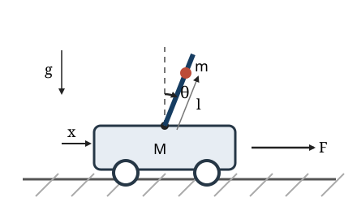

# 拉格朗日动力学建模

动力学把质量分布、运动状态和外力联系起来。对多关节机构，牛顿—欧拉法逐刚体写力和力矩平衡；拉格朗日法选择广义坐标，用动能、势能和广义力直接得到关于自由度的方程。后者尤其适合推导和检查复杂耦合项。

## 1. 广义坐标、约束与虚功

用 $q=[q_1,\ldots,q_n]^\mathsf{T}$ 描述系统构型。$q_i$ 可以是角度，也可以是长度；它们不必是直角坐标，但应足以唯一描述当前构型。速度是 $\dot q$，加速度是 $\ddot q$。

约束可以写成不同形式：

- **完整（holonomic）约束**：可以写为 $g(q,t)=0$，如刚性杆长度固定。满足独立约束后，常可减少所需广义坐标数。
- **非完整（nonholonomic）约束**：通常写成 $A(q,t)\dot q+b(q,t)=0$，但不能积分成只关于 $q,t$ 的约束，例如无侧滑滚动约束。它直接限制速度，不一定减少构型空间维数。
- 机械限位通常是 $q_{\min}\le q\le q_{\max}$，属于不等式边界；不能把它与等式约束或“可解/不可解”的划分混为一谈。

虚位移 $\delta q$ 是在同一时刻满足理想约束的无穷小构型改变。理想约束力对允许虚位移不做虚功。非保守外力、驱动转矩和摩擦则通过广义力 $Q$ 表示：
$$
\delta W=Q^\mathsf{T}\delta q.
$$
广义力的量纲取决于对应坐标：平移坐标对应力，转动坐标对应力矩。

## 2. 从能量到 Euler–Lagrange 方程

先求系统总动能 $T(q,\dot q,t)$ 与势能 $U(q,t)$，定义拉格朗日量
$$
L(q,\dot q,t)=T(q,\dot q,t)-U(q,t).
$$
达朗贝尔原理将动力学问题写成任意允许虚位移下的平衡；利用
$$
\frac{d}{dt}\left(\frac{\partial L}{\partial\dot q_i}\right)
-\frac{\partial L}{\partial q_i}=Q_i
\tag{1}
$$
得到第二类拉格朗日方程。$Q_i$ 只包括未由 $L$ 中势能表示的非保守广义力。式 (1) 中负号与 $L=T-U$ 配套。

若约束 $g(q,t)=0$ 由理想约束力实现，一种常见写法是
$$
\frac{d}{dt}\frac{\partial L}{\partial\dot q}
-\frac{\partial L}{\partial q}
=Q_\mathrm{nc}+J_g(q,t)^\mathsf{T}\lambda,\qquad
J_g=\frac{\partial g}{\partial q}.
$$
$\lambda$ 是约束力的拉格朗日乘子。也可消去依赖坐标，得到降维方程；选用哪种形式取决于约束是否易于参数化及是否需要求接触力。

### 单摆：逐项代入

质量 $m$ 通过长度为 $l$ 的轻杆绕固定点转动，角度 $\theta=0$ 取最低点，正向角度由约定决定。以最低点为势能零点：
$$
T=\tfrac12ml^2\dot\theta^2,\qquad
U=mgl(1-\cos\theta),\qquad
L=\tfrac12ml^2\dot\theta^2-mgl(1-\cos\theta).
$$
逐项求偏导：
$$
\frac{\partial L}{\partial\dot\theta}=ml^2\dot\theta,\quad
\frac{d}{dt}\frac{\partial L}{\partial\dot\theta}=ml^2\ddot\theta,\quad
\frac{\partial L}{\partial\theta}=-mgl\sin\theta.
$$
代入 (1)，再加入外加转矩 $\tau$ 与黏性阻尼 $b\dot\theta$，得到
$$
ml^2\ddot\theta+b\dot\theta+mgl\sin\theta=\tau.
$$
小角度下 $\sin\theta\approx\theta$，方程线性化为
$$
ml^2\ddot\theta+b\dot\theta+mgl\theta=\tau.
$$
线性化只在 $\theta$ 足够小时准确，不能拿来代表大幅摆动。

### 小车—倒立摆：保留耦合项

取广义坐标 $q=(x,\theta)$：小车沿水平轴位移 $x$，摆杆质心距铰点 $l$，$\theta=0$ 表示摆杆竖直向上。摆杆质量为 $m$，绕质心转动惯量为 $I$，小车质量为 $M$。质心位置取
$$
p_c=(x+l\sin\theta,\ l\cos\theta).
$$
因此
$$
\begin{aligned}
T={}&\tfrac12(M+m)\dot x^2
+ml\cos\theta\,\dot x\dot\theta
+\tfrac12(I+ml^2)\dot\theta^2,\\
U={}&mgl\cos\theta,\qquad L=T-U.
\end{aligned}
$$
忽略铰链摩擦时，若小车受水平力 $F$，摆轴外力矩为 $\tau$，拉格朗日方程给出
$$
\begin{aligned}
(M+m)\ddot x+ml\cos\theta\,\ddot\theta
-ml\sin\theta\,\dot\theta^2 &= F,\\
ml\cos\theta\,\ddot x+(I+ml^2)\ddot\theta
-mgl\sin\theta &= \tau.
\end{aligned}
\tag{2}
$$
式 (2) 展示了质量耦合、科氏/向心项与重力项。若把 $\theta$ 改为从竖直向下计量，势能和重力项的符号会变；坐标定义必须与模型、传感器零位和控制器参考一致。

## 3. 多关节刚体的标准形式

对由刚性连杆构成且自由度独立的机械臂，第 $i$ 个连杆质心的线速度和角速度可由雅可比写为
$$
v_i=J_{v,i}(q)\dot q,\qquad
\omega_i=J_{\omega,i}(q)\dot q.
$$
若连杆质量为 $m_i$，其质心坐标系下惯量张量为 $I_i$，旋转矩阵为 $R_i(q)$，则
$$
T=\tfrac12\dot q^\mathsf{T}M(q)\dot q,
$$
其中
$$
M(q)=\sum_i\left(
m_iJ_{v,i}^\mathsf{T}J_{v,i}
+J_{\omega,i}^\mathsf{T}R_iI_iR_i^\mathsf{T}J_{\omega,i}
\right).
$$
势能可写成 $U(q)=\sum_i m_i g\,z_i(q)$，其中 $z_i$ 是相对选定重力势能基准的高度。将能量代入拉格朗日方程，通常整理为
$$
M(q)\ddot q+C(q,\dot q)\dot q+g(q)+\tau_f(\dot q)
=\tau+J_\mathrm{ext}(q)^\mathsf{T}F_\mathrm{ext}.
\tag{3}
$$
$M$ 为对称正定惯量矩阵；$C\dot q$ 收集科氏与离心项；$g=\partial U/\partial q$；$\tau_f$ 表示建模的摩擦；外力 $F_\mathrm{ext}$ 通过雅可比转置映射到关节空间。$C$ 矩阵本身的表达不唯一，物理上有意义的是乘积 $C(q,\dot q)\dot q$。不同文献会把重力向量移到等式另一边，写式 (3) 时必须说明符号约定。

在驱动器和关节之间存在减速器时，关节速度、转矩、惯量还要经过传动比与效率映射；电机电流或转速指令不能未经换算就当作关节力矩。动力学模型适用于刚体近似和已知接触条件；柔性、齿隙、摩擦、结构变形和未建模负载会造成误差。

## 4. 建模步骤与检查

建议按以下顺序推导，避免先展开庞大的三角表达式：

1. 画自由体图，明确质量、质心、转动惯量、关节轴、重力方向和外力作用点。
2. 选择最少且独立的广义坐标，写出约束方程以及它们的时间导数。
3. 用几何关系求各质心位置、线速度和角速度；先保留雅可比形式。
4. 汇总动能、势能；核对每一项的单位都为焦耳。
5. 写广义非保守力，确认力/力矩与坐标排列一一对应。
6. 对各坐标应用 Euler–Lagrange 方程，整理为 $M\ddot q=f(q,\dot q,\tau)$。
7. 做结构检查：$M=M^\mathsf{T}$；在可运动构型上应正定；无输入、无摩擦、无外力时检查机械能守恒；在零速度和静止姿态下重力项应符合静力平衡。
8. 对简单构型用牛顿—欧拉或数值仿真独立核对方向、符号和量纲。

约束轮系、接触和完整动力学常需使用乘子或互补条件；只在速度方程上加惩罚项可能引入不必要的刚性或漂移。

## 5. 用符号工具辅助，而不替代建模

SymPy 的 physics/mechanics 模块可声明广义坐标、参考系、质点/刚体、约束和外力，并用 LagrangesMethod 形成方程、质量矩阵和 forcing 项。推荐先手工写清几何定义，再让符号工具微分和化简；输出应与手推的简化例子及量纲检查交叉验证。

下面是 API 片段，需在同一 Python 会话中先定义 q、qd、L 等对象；它用于说明接口，不作为独立可执行程序：

~~~python
from sympy.physics.mechanics import LagrangesMethod

# L 是由模型动能减势能得到的拉格朗日量
# q 是广义坐标列表
method = LagrangesMethod(L, q)
equations = method.form_lagranges_equations()
mass_matrix = method.mass_matrix
forcing = method.forcing
~~~

符号推导能减少机械微分错误，却不会发现错误的坐标原点、惯量轴、自由体图或正方向；代码运行成功不等同于模型物理正确。

## 参考资料

- [SymPy 官方文档：Lagrange 方法与约束系统接口](https://docs.sympy.org/latest/modules/physics/mechanics/lagrange.html)
- [MIT Underactuated Robotics：多体动力学与机械臂标准形式](https://underactuated.mit.edu/multibody.html)
- 运动学与雅可比定义见 [Modern Robotics](https://modernrobotics.northwestern.edu/nu-gm-book-resource/)。
