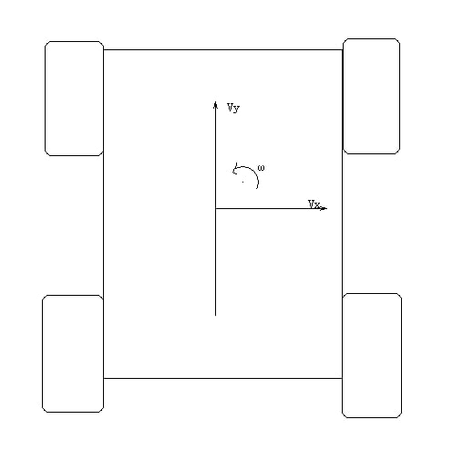
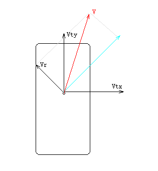
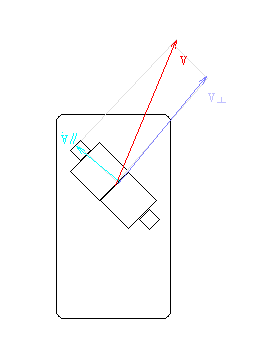
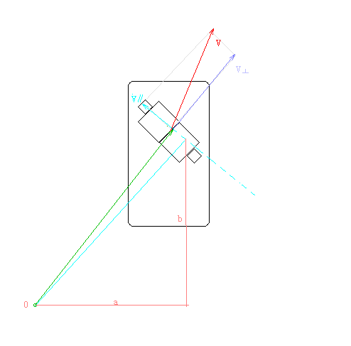

# 机器人运动学与移动底盘

运动学描述几何量之间的关系，不涉及质量、力矩或能量。它回答两类问题：给定关节或轮子的运动，机器人会怎样动（正运动学）；为了得到期望运动，应给关节或轮子什么速度（逆运动学）。

## 1. 先固定坐标和符号

本文平面底盘采用右手车体坐标系：$x$ 向前、$y$ 向左、$z$ 向上；绕 $z$ 轴逆时针角速度 $\omega$ 为正。速度向量按
$$
\boldsymbol{\xi}_b=[v_x,\ v_y,\ \omega]^\mathsf{T}
$$
排列。所有轮速先表示为线速度，最后才除以轮半径换算成角速度。轮序固定为左前 FL、右前 FR、左后 RL、右后 RR。改变任一约定都会改变矩阵中的正负号。

三维刚体位姿可用齐次变换表示：
$$
T=\begin{bmatrix}R&p\\0&1\end{bmatrix}\in SE(3),
$$
其中 $R\in SO(3)$ 描述方向，$p\in\mathbb R^3$ 描述位置。它作用于齐次点 $[x,y,z,1]^\mathsf{T}$，所以完整变换是 $4\times4$，不是单独的 $3\times3$ 矩阵。若 $T^A_B$ 把 B 系坐标变到 A 系，串联变换按路径相乘：
$$
T^0_n=T^0_1T^1_2\cdots T^{n-1}_n.
$$
矩阵乘法不可交换；核对每个变换的“从哪一系到哪一系”、单位与乘法顺序，比背某一种坐标系参数表更重要。齐次变换与旋转误差的深入内容见[坐标变换与传感器标定](../坐标变换与传感器标定/坐标系、刚体变换与TF.md)。

## 2. 串联机械臂的正运动学与逆运动学

正运动学把关节变量 $q$ 映射到末端位姿 $T(q)$。可以为每个关节建立局部坐标系，然后把相邻关节间的旋转与平移相乘。Denavit–Hartenberg 参数是一种约定好的参数化方式，不是唯一建系方法；若两个关节轴平行或相交，选取坐标系时要按约定处理退化情形。

### 平面二连杆例子

两杆长度为 $l_1,l_2$，关节角 $q_1,q_2$ 从同一平面参考轴测量。末端位置为
$$
\begin{aligned}
x &= l_1\cos q_1+l_2\cos(q_1+q_2),\\
y &= l_1\sin q_1+l_2\sin(q_1+q_2).
\end{aligned}
$$
这就是正运动学。给定 $(x,y)$ 求关节角时，先由余弦定理得到
$$
\cos q_2=\frac{x^2+y^2-l_1^2-l_2^2}{2l_1l_2},
$$
再计算
$$
\begin{aligned}
q_2 &= \operatorname{atan2}\left(\pm\sqrt{1-\cos^2q_2},\cos q_2\right),\\
q_1 &= \operatorname{atan2}(y,x)
-\operatorname{atan2}\left(l_2\sin q_2,\ l_1+l_2\cos q_2\right).
\end{aligned}
$$
$\pm$ 通常对应肘上、肘下两支解。可达条件是
$$
|l_1-l_2|\le\sqrt{x^2+y^2}\le l_1+l_2.
$$
处在可达边界时，两个连杆共线，雅可比降秩，末端某些方向的瞬时运动能力消失。实际求解还要筛除超过关节限位、碰撞或接近奇异位形的分支。空间机械臂的逆运动学通常也有多解、无解和数值病态问题；“目标位姿存在”不等于“机构在关节限制内可到达”。

### 微分运动学与数值逆解

在当前关节位形附近，小运动满足
$$
\dot x=J(q)\dot q,\qquad
\Delta x\approx J(q)\Delta q.
$$
平面二连杆的位置雅可比为
$$
J(q)=
\begin{bmatrix}
-l_1\sin q_1-l_2\sin(q_1+q_2)&-l_2\sin(q_1+q_2)\\
l_1\cos q_1+l_2\cos(q_1+q_2)&l_2\cos(q_1+q_2)
\end{bmatrix}.
$$
逆速度问题可解 $J\dot q=\dot x_d$。若 $J$ 可逆，可直接求解；冗余或欠驱动情形要用伪逆或优化方法。接近奇异点时直接伪逆会放大噪声，可用阻尼最小二乘：
$$
\dot q=J^\mathsf{T}(JJ^\mathsf{T}+\lambda^2I)^{-1}\dot x_d.
$$
$\lambda>0$ 限制关节速度放大，但会带来末端跟踪偏差。若同时包含位置（米）和姿态（弧度），需给误差和权重合理尺度；姿态误差应在旋转群上计算，例如采用相对旋转的对数映射，不宜把两个旋转矩阵逐元素相减当作角度误差。

## 3. 轮式底盘的统一模型

对于车体平面速度 $(v_x,v_y,\omega)$，位于车体坐标 $(x_i,y_i)$ 的轮心速度为
$$
\boldsymbol v_i=
\begin{bmatrix}
v_x-\omega y_i\\v_y+\omega x_i
\end{bmatrix}.
$$
这是刚体速度关系 $v_i=v_0+\omega\times r_i$ 在平面上的展开。轮系模型的核心，是把每个轮心的速度投影到轮子能驱动或约束的方向，再将轮子运动单位转换到编码器角速度。

若底盘位姿为世界系 $(x,y,\theta)$，车体系平移速度转换到世界系：
$$
\dot x=v_x\cos\theta-v_y\sin\theta,\quad
\dot y=v_x\sin\theta+v_y\cos\theta,\quad
\dot\theta=\omega.
$$
里程计将该速度对时间积分；轮胎滑移、地面不平、轮径/轮距误差和时间戳抖动都会积累为漂移。多传感器融合和坐标系主讲见[SLAM 与定位](../SLAM与定位/SLAM建模与Cartographer局部建图.md)。

## 4. 麦克纳姆轮：从辊子约束推导

麦克纳姆轮通过倾斜辊子提供一个被动自由运动方向。接触点速度沿辊子轴在地面切平面内的投影受到约束；与该轴垂直的切向速度可由辊子自转吸收，构成被动自由滚动方向。轮子本体的转动驱动约束方向上的速度。必须从具体辊子排布确认每个轮的方向与符号，不能只凭“麦轮公式”照抄。[现代机器人学的全向轮运动学推导](https://modernrobotics.northwestern.edu/nu-gm-book-resource/13-2-omnidirectional-wheeled-mobile-robots-part-1-of-2/)说明了主动驱动方向的无滑移约束和与之垂直的自由滑动方向；一项麦克纳姆/全向轮研究也用辊子自由滚动方向解释这两个自由度。

下图示意车体速度如何分解到轮心与辊子接触方向。它用于理解几何投影，本文矩阵则按照本节开头明确的 FL、FR、RL、RR 轮序和右手车体坐标重新推导。

设矩形底盘半长为 $a$、半宽为 $b$，$L=a+b$，轮半径为 $r$。每个 $n_i$ 沿相应辊子轴在接触切平面内的方向，也就是无侧滑的受约束方向；用同一坐标系表达，按本文指定轮序有
$$
n_{FL}=(1,-1)^\mathsf{T},\quad
n_{FR}=(1,1)^\mathsf{T},\quad
n_{RL}=(1,1)^\mathsf{T},\quad
n_{RR}=(1,-1)^\mathsf{T}.
$$

其垂直方向是辊子可被动滚动的方向。四轮接触方向的有效约束取
$$
n_i^\mathsf{T}\bigl(v_i-r\dot\phi_i e_x\bigr)=0,
$$
其中 $e_x=[1,0]^\mathsf{T}$，$n_i$ 是每个轮对应的受约束方向。45° 辊子满足 $|n_{ix}|=|n_{iy}|$；将其单位方向投影并约去相同的 $1/\sqrt2$ 因子，按本节约定可得轮子的周向线速度：
$$
\begin{bmatrix}
r\dot\phi_{FL}\\
r\dot\phi_{FR}\\
r\dot\phi_{RL}\\
r\dot\phi_{RR}
\end{bmatrix}
=
\underbrace{\begin{bmatrix}
1&-1&-L\\
1&+1&+L\\
1&+1&-L\\
1&-1&+L
\end{bmatrix}}_{A}
\begin{bmatrix}v_x\\v_y\\\omega\end{bmatrix}.
\tag{1}
$$
因此逆运动学为
$$
\dot{\boldsymbol\phi}=r^{-1}A\boldsymbol\xi_b.
$$
各列来自三个叠加运动：纵向平移令四轮同向转，横向平移按辊子手性分成两正两负，绕中心旋转则由 $-y_i$ 与 $x_i$ 的力臂项形成对角正负号。这个分解也可用于逐列检查轮序和电机接线。

四轮正运动学是超定方程，理想情况下用最小二乘伪逆恢复车体速度。由于本矩阵的三列正交，
$$
\begin{aligned}
v_x&=\frac r4(\dot\phi_{FL}+\dot\phi_{FR}+\dot\phi_{RL}+\dot\phi_{RR}),\\
v_y&=\frac r4(-\dot\phi_{FL}+\dot\phi_{FR}+\dot\phi_{RL}-\dot\phi_{RR}),\\
\omega&=\frac r{4L}(-\dot\phi_{FL}+\dot\phi_{FR}-\dot\phi_{RL}+\dot\phi_{RR}).
\end{aligned}
\tag{2}
$$
真实底盘可将各轮半径、有效力臂分别标定后用加权最小二乘。残差 $r\dot\phi-A\boldsymbol\xi_b$ 可作为轮滑、方向错误或轮径偏差的诊断量。

若某轮最大允许角速度为 $\dot\phi_{\max}$，计算完四轮命令后，令 $s=\max_i|\dot\phi_i|$。若 $s=0$，所有轮命令已为零，直接取 $\alpha=1$；否则取
$$
\alpha=\min\left(1,\frac{\dot\phi_{\max}}{s}\right),\qquad
\dot{\boldsymbol\phi}\leftarrow\alpha\dot{\boldsymbol\phi}.
$$
统一缩放保留原运动方向；分别截断每个轮速会改变期望底盘速度。式 (1) 的符号只对本节的轮序、坐标正向和辊子排布成立：架空轮子低速验证正反方向，再以小幅直行、横移和原地旋转分别核对编码器符号。

## 5. 全向轮与舵轮

### 固定方向全向轮

理想全向轮的滚子提供一个垂直于滚子轴的被动滚动方向；其互相垂直的有效驱动方向提供一个速度约束。把轮心速度投影到轮子的有效驱动/约束方向 $d_i$，可写成
$$
\rho_i\dot\phi_i=d_i^\mathsf{T}\boldsymbol v_i
=d_i^\mathsf{T}
\begin{bmatrix}
1&0&-y_i\\0&1&x_i
\end{bmatrix}
\boldsymbol\xi_b.
$$
堆叠各轮得到 $D\boldsymbol\xi_b=\mathcal R\dot{\boldsymbol\phi}$，其中 $\mathcal R=\operatorname{diag}(\rho_1,\ldots,\rho_n)$ 是轮半径矩阵。若矩阵对车体速度满列秩，可由 $D^+$ 估计底盘速度；若秩不足，则某些平移方向不可独立控制。三轮 120° 布置是常见全向结构，但滚子角和轮子朝向不同会改变每一行。工程上应由真实轮子方向向量重新构造矩阵，而不是仅按轮数选公式。

以三个等半径全向轮按圆周均匀布置、驱动方向沿圆的切线为例。令第 $i$ 个轮心到车体中心的距离为 $\ell$，位置为
$\boldsymbol p_i=\ell[\cos\alpha_i,\sin\alpha_i]^\mathsf{T}$，且驱动方向
$d_i=[-\sin\alpha_i,\cos\alpha_i]^\mathsf{T}$。轮心速度为
$\boldsymbol v_i=[v_x-\omega\ell\sin\alpha_i,\ v_y+\omega\ell\cos\alpha_i]^\mathsf{T}$，所以
$$
r\dot\phi_i=d_i^\mathsf{T}\boldsymbol v_i
=-\sin\alpha_i\,v_x+\cos\alpha_i\,v_y+\ell\omega.
$$
取 $\alpha_i\in\{0,2\pi/3,4\pi/3\}$ 并堆叠三行，得到
$$
r
\begin{bmatrix}\dot\phi_1\\\dot\phi_2\\\dot\phi_3\end{bmatrix}
=
\begin{bmatrix}
0&1&\ell\\
-\sqrt3/2&-1/2&\ell\\
\sqrt3/2&-1/2&\ell
\end{bmatrix}
\begin{bmatrix}v_x\\v_y\\\omega\end{bmatrix}.
$$
在这组对称布置和正方向约定下，矩阵满秩，三个轮速可反解三个底盘自由度；更一般的布局应用实际轮心位置 $\boldsymbol p_i$、驱动方向 $d_i$ 和半径 $\rho_i$ 重建雅可比。

### 舵轮（转向轮）

舵轮每个模块同时控制转向角 $\delta_i$ 和驱动速度 $\dot\phi_i$。给定车体速度，先求轮心速度
$$
\boldsymbol v_i=
\begin{bmatrix}
v_x-\omega y_i\\v_y+\omega x_i
\end{bmatrix}.
$$
转向目标为
$$
\delta_i=\operatorname{atan2}(v_{iy},v_{ix}),\qquad
\rho_i\dot\phi_i=\sqrt{v_{ix}^2+v_{iy}^2}.
$$
若转向角可跨越 $\pi$，可将目标角加减 $\pi$ 并反转驱动轮速度，选择关节距离较小的一支；该等价变换必须与电机符号和限位一致。模块目标速度接近零时，转向角在数值上不确定，应保留上一角度或采用设计好的停转策略。接收轮速反馈后可把各模块约束重新拟合为底盘速度，用于里程计和残差监控。

## 6. 机构选型与实际误差

| 轮系 | 可直接控制的平面速度 | 主要条件与代价 |
|---|---|---|
| 差速/两驱 | 纵向速度与偏航；侧向速度受非完整约束 | 结构简单；不能原地平移 |
| 固定全向轮 | 取决于轮子有效滚动方向矩阵 | 可横移；对地面平整、滚子状态敏感 |
| 麦克纳姆轮 | 理想情况下可控制 $v_x,v_y,\omega$ | 辊子方向与轮序必须匹配；侧向力/效率受接触几何与地面影响 |
| 舵轮 | 轮模块转向与驱动共同形成任意平面运动 | 机构复杂，转向动态、角度限位和零速角度处理重要 |

“全向”表示运动学上可在平面内产生多个瞬时速度分量，不意味着在任意地面上都能无损耗、无滑移或具有各方向相同的牵引能力。

## 参考资料

- [Modern Robotics：正运动学、逆运动学与速度运动学](https://modernrobotics.northwestern.edu/nu-gm-book-resource/)
- [Modern Robotics 第 13.2 节：全向轮和麦克纳姆轮的速度约束](https://modernrobotics.northwestern.edu/nu-gm-book-resource/13-2-omnidirectional-wheeled-mobile-robots-part-1-of-2/)
- [ros2_controllers：麦克纳姆驱动控制器接口说明](https://github.com/ros-controls/ros2_controllers/blob/master/mecanum_drive_controller/doc/userdoc.rst)
- [全向轮与麦克纳姆轮的滚子自由度说明及运动学研究](https://www.mdpi.com/2075-1702/11/7/698)
- 坐标变换详解见本知识库[坐标变换与传感器标定](../坐标变换与传感器标定/坐标系、刚体变换与TF.md)。
